# Java 1 — дополнительный материал

# IntelliJ IDEA и дебаггер: рабочий цикл разработчика

Этот материал дополняет семинар после **недели 2** курса Java.

К этому моменту предполагается, что вы уже знакомы с:

- переменными;
- условиями;
- циклами;
- методами;
- параметрами и `return`;
- массивами;
- базовой работой со строками.

Классы и объекты подробно ещё не нужны. Поэтому все основные примеры ниже построены на методах, локальных переменных и массивах.

---

# 1. Зачем вообще нужен этот материал

Когда программа небольшая, ошибку иногда удаётся заметить сразу.

Например:

```java
int result = 10 + 20;
```

Если ожидали `30`, а получили другое значение, найти проблему обычно легко.

Но программа быстро становится сложнее:

```text
main()
    вызывает метод
        внутри метода есть цикл
            внутри цикла меняются переменные
                результат зависит от нескольких итераций
```

В такой ситуации плохо работает подход:

> «Буду случайно менять код, пока программа не начнёт работать».

Нам нужен воспроизводимый рабочий процесс.

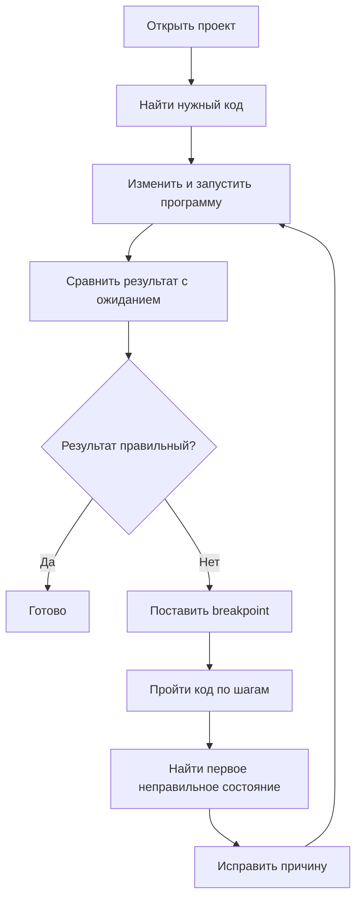

Главная идея:

> **IDE помогает работать с кодом, а дебаггер помогает наблюдать выполняющуюся программу.**

---

# 2. IntelliJ IDEA и JDK — не одно и то же

IntelliJ IDEA — это **среда разработки**.

Она помогает:

- открывать проект;
- редактировать код;
- находить ошибки;
- искать классы и методы;
- запускать Java-программы;
- работать с дебаггером.

JDK — это набор инструментов Java.

В него входят, в частности:

- компилятор Java;
- средства запуска Java-программ;
- стандартные библиотеки и другие инструменты.

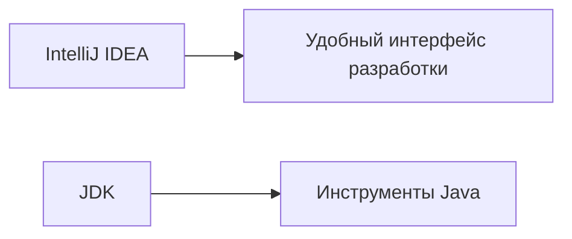

Когда вы нажимаете `Run` в IntelliJ IDEA, IDE не создаёт какой-то отдельный язык или отдельную Java.

Она использует установленный JDK и автоматизирует запуск программы.

---

# 3. Открываем именно проект

Одна из типичных ошибок новичка — открыть отдельный файл:

```text
Main.java
```

вместо каталога проекта.

Правильнее открыть папку целиком.

Пример:

```text
ide-debugger-demo/
└── src/
    ├── Main.java
    └── Calculator.java
```

Почему это важно?

IDE должна понимать:

- где находится корень проекта;
- какие файлы относятся к проекту;
- где лежит исходный код;
- какой JDK используется;
- какие классы связаны между собой.

---

# 4. Основные области IntelliJ IDEA

На текущем этапе вам достаточно уверенно ориентироваться в четырёх областях.

## Project

Показывает структуру проекта:

```text
src/
Main.java
Calculator.java
...
```

Здесь удобно:

- открывать файлы;
- создавать новые файлы;
- видеть структуру каталогов.

## Editor

Основная область, где находится Java-код.

Здесь вы:

- пишете код;
- видите подсветку;
- получаете подсказки;
- переходите к объявлениям;
- ставите breakpoints.

## Run

Появляется при обычном запуске программы.

Здесь видно:

- вывод `System.out.println(...)`;
- сообщения программы;
- ошибки выполнения;
- код завершения процесса.

## Debug

Появляется при запуске под дебаггером.

Здесь можно увидеть:

- текущую строку;
- локальные переменные;
- параметры методов;
- элементы массива;
- стек вызовов.

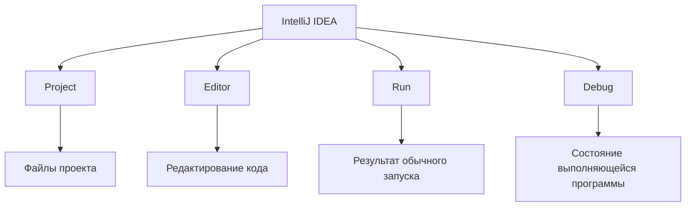

---

# 4.1. Полезные hot keys

Ниже — сочетания клавиш для **стандартных keymap IntelliJ IDEA**.

Они могут отличаться, если вы:

- меняли keymap;
- используете keymap от другого редактора;
- переназначали сочетания клавиш;
- используете системные сочетания macOS, которые конфликтуют с IntelliJ IDEA.

Посмотреть актуальные сочетания можно в:

```text
Settings / Preferences
→ Keymap
```

На macOS для `F7`, `F8` и других функциональных клавиш иногда нужно дополнительно удерживать `Fn` — это зависит от настроек клавиатуры.

## Базовая работа в IDE

| Действие | Windows | macOS |
|---|---|---|
| Search Everywhere | `Shift` два раза | `Shift` два раза |
| Quick Fix / Context Actions | `Alt + Enter` | `⌥ + Enter` |
| Reformat Code | `Ctrl + Alt + L` | `⌘ + ⌥ + L` |
| Go to Declaration | `Ctrl + B` | `⌘ + B` |
| Find Usages | `Alt + F7` | `⌥ + F7` |
| Rename | `Shift + F6` | `Shift + F6` |
| открыть Project | `Alt + 1` | `⌘ + 1` |
| открыть Run | `Alt + 4` | `⌘ + 4` |
| открыть Debug | `Alt + 5` | `⌘ + 5` |

Не нужно пытаться запомнить всё сразу.

Для начала достаточно привыкнуть к:

```text
Search Everywhere
Reformat Code
Go to Declaration
Find Usages
Rename
```

## Run и Debug

| Действие | Windows | macOS |
|---|---|---|
| Run текущей конфигурации | `Shift + F10` | `⌃ + R` |
| Debug текущей конфигурации | `Shift + F9` | `⌃ + D` |
| Stop | `Ctrl + F2` | `⌘ + F2` |
| Toggle Line Breakpoint | `Ctrl + F8` | `⌘ + F8` |
| Step Over | `F8` | `F8` |
| Step Into | `F7` | `F7` |
| Step Out | `Shift + F8` | `Shift + F8` |
| Resume Program | `F9` | `⌘ + ⌥ + R` |
| Evaluate Expression | `Alt + F8` | `⌥ + F8` |

Для дебаггера особенно полезно выучить четыре команды:

```text
Step Over
Step Into
Step Out
Resume Program
```

Остальные сочетания можно первое время вызывать мышью и постепенно запоминать.

---

# 5. Вкладки редактора

Когда вы открываете несколько файлов, они появляются во вкладках редактора.

Например:

```text
Main.java | Calculator.java
```

Закрытие вкладки:

> **не удаляет файл из проекта.**

Это только закрывает его отображение в редакторе.

Файл остаётся в `Project`.

---

# 6. Автодополнение

IntelliJ IDEA знает структуру Java-кода и может предлагать возможные продолжения.

Например, начните писать:

```java
System.out.
```

IDE покажет доступные методы.

То же самое работает для ваших переменных и методов.

Например:

```java
int totalScore = 100;
```

Ниже начните вводить:

```java
tot
```

IDE может предложить:

```java
totalScore
```

Автодополнение помогает:

- меньше печатать;
- реже ошибаться в именах;
- видеть доступные операции.

Но важно понимать:

> **IDE знает синтаксис и структуру программы, но не знает, какой алгоритм вам нужен.**

---

# 7. Reformat Code

Код может работать и при плохом форматировании:

```java
public static int sum(int[] numbers){
int result=0;
for(int number:numbers){
result+=number;
}
return result;
}
```

После форматирования он становится заметно понятнее:

```java
public static int sum(int[] numbers) {
    int result = 0;

    for (int number : numbers) {
        result += number;
    }

    return result;
}
```

`Reformat Code` (`Ctrl + Alt + L` на Windows, `⌘ + ⌥ + L` на macOS) исправляет:

- отступы;
- пробелы;
- переносы;
- оформление блоков.

Но:

> `Reformat Code` **не исправляет алгоритм**.

Если программа неправильно считает сумму, красивое форматирование не сделает результат правильным.

---

# 8. Ошибки и предупреждения

IntelliJ IDEA постоянно анализирует код.

При этом важно различать как минимум две ситуации.

## Ошибка

Например:

```java
int age = "18";
```

`int` ожидает целое число, а справа находится строка.

Такой код не должен успешно скомпилироваться.

IDE обычно выделит проблему красным.

## Warning

Например:

```java
int unused = 100;
```

Переменная объявлена, но нигде не используется.

Программа может компилироваться и запускаться.

IDE сообщает:

> Возможно, здесь есть лишний или подозрительный код.

Это не обязательно запрещает запуск.

## Правильная реакция на подсветку

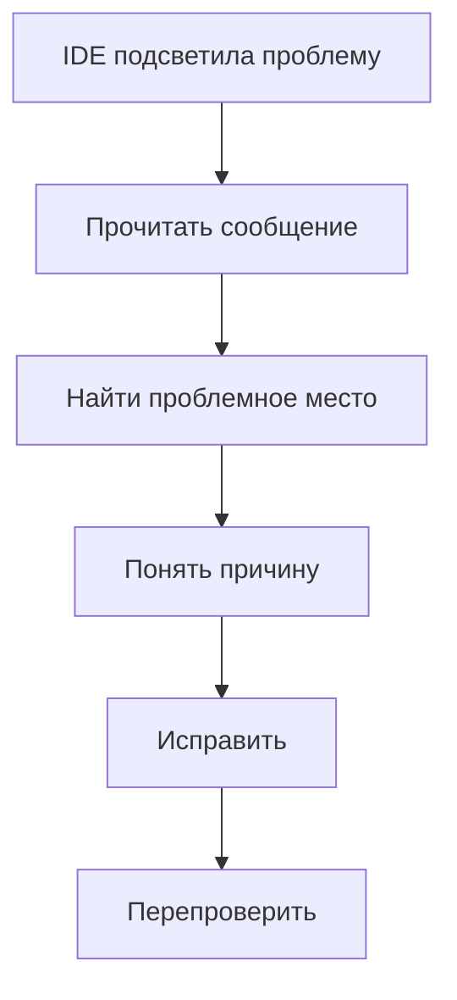

Плохой подход:

> «Вижу красное → случайно меняю строки → надеюсь, что исчезнет».

---

# 9. Quick Fix / Context Actions

На некоторых проблемах IntelliJ IDEA умеет предложить возможные действия.

Например:

- добавить import;
- изменить тип;
- создать отсутствующий метод;
- исправить часть синтаксиса.

Но `Quick Fix` нужно воспринимать не как:

> «IDE, исправь программу».

А как:

> «IDE, покажи возможные действия для этого места».

Перед применением варианта нужно понимать:

- что именно изменится;
- подходит ли это вашей задаче;
- не маскируете ли вы реальную проблему.

---

# 10. Search Everywhere

В небольшом проекте нужный файл можно найти глазами.

В более крупном проекте это быстро перестаёт работать.

`Search Everywhere` (`Shift` два раза на Windows и macOS) позволяет искать:

- класс;
- файл;
- метод;
- действие IDE.

Например, если в проекте есть:

```text
Main.java
Calculator.java
TemperatureAnalyzer.java
PasswordValidator.java
```

необязательно раскрывать все папки и искать глазами.

Можно начать вводить:

```text
Calculator
```

и сразу открыть нужный класс.

---

# 11. Go to Declaration

Предположим, в `Main` написано:

```java
int result = Calculator.sum(numbers);
```

Вы хотите понять:

> Где объявлен `sum()`?

Вместо ручного поиска можно перейти к объявлению.

IDE откроет место, где определён метод:

```java
public static int sum(int[] numbers) {
    ...
}
```

Это особенно важно при работе с несколькими файлами.

---

# 12. Find Usages

Теперь обратная задача.

Вы смотрите на метод:

```java
public static int sum(int[] numbers) {
    ...
}
```

и хотите узнать:

> Где он вызывается?

`Find Usages` (`Alt + F7` на Windows, `⌥ + F7` на macOS) показывает использования элемента в проекте.

Это полезно перед изменением метода:

```text
Кто его вызывает?
Сколько мест зависит от него?
Что может измениться после редактирования?
```

---

# 13. Rename Refactoring

Допустим:

```java
int x = sum(numbers);

System.out.println(x);
```

Название `x` почти ничего не объясняет.

Хотим:

```java
int total = sum(numbers);

System.out.println(total);
```

Можно просто заменить текст вручную.

Но в реальном проекте имя может использоваться во многих местах.

`Rename` (`Shift + F6` на Windows и macOS) понимает структуру программы и обновляет связанные использования.

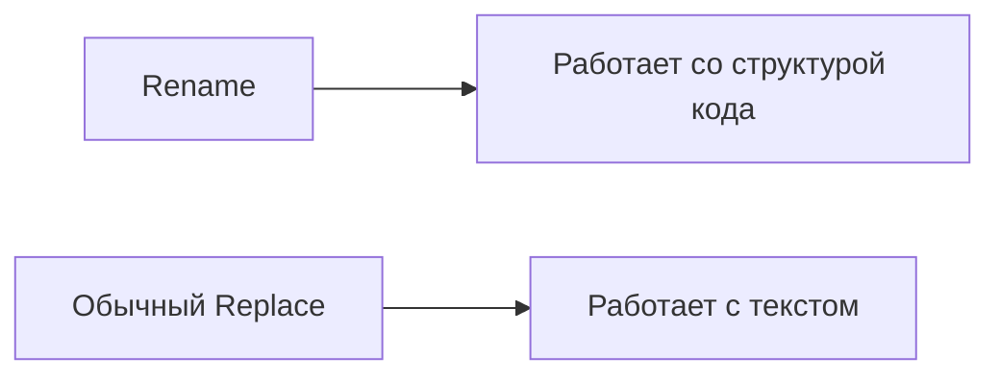

Для переменной, метода или класса безопаснее использовать рефакторинг `Rename`.

---

# 14. Обычный запуск программы

Рассмотрим программу:

```java
public class Main {

    public static void main(String[] args) {
        int[] numbers = {10, 20, 30};

        System.out.println(sum(numbers));
    }

    public static int sum(int[] numbers) {
        int result = 0;

        for (int number : numbers) {
            result += number;
        }

        return result;
    }
}
```

Ожидаем:

```text
60
```

При обычном запуске программа:

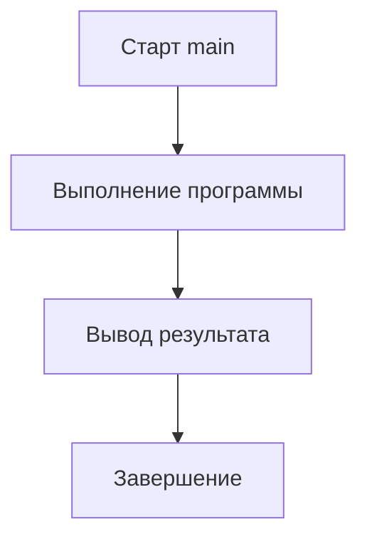

В окне `Run` увидим результат.

---

# 15. Что означает `exit code 0`

После завершения IntelliJ IDEA может показать:

```text
Process finished with exit code 0
```

Это означает примерно:

> Процесс завершился штатно.

Но это **не означает**:

> Алгоритм дал правильный ответ.

Например:

```java
System.out.println(2 + 2);
```

можно заменить на:

```java
System.out.println(2 + 3);
```

Программа прекрасно запустится.

`exit code 0` останется.

Но если по условию ожидалось `4`, программа логически неправильная.

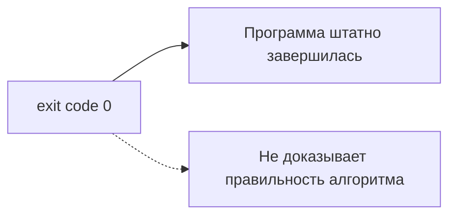

---

# 16. Три разных типа проблем

На текущем этапе полезно различать три ситуации.

| Вид проблемы | Пример |
|---|---|
| ошибка компиляции | `int age = "18";` |
| ошибка выполнения | обращение к несуществующему индексу массива |
| логическая ошибка | программа запускается, но считает неправильно |

Дебаггер особенно полезен для третьего случая:

> Код компилируется и запускается, но результат не соответствует ожиданию.

---

# 17. Что такое Debug

`Run` отвечает в основном на вопрос:

> Какой результат получит программа?

`Debug` позволяет задавать другие вопросы:

- какое сейчас значение переменной?
- какой элемент массива обрабатывается?
- сколько итераций уже прошло?
- какой параметр получил метод?
- откуда был вызван текущий метод?
- после какой строки значение стало неправильным?

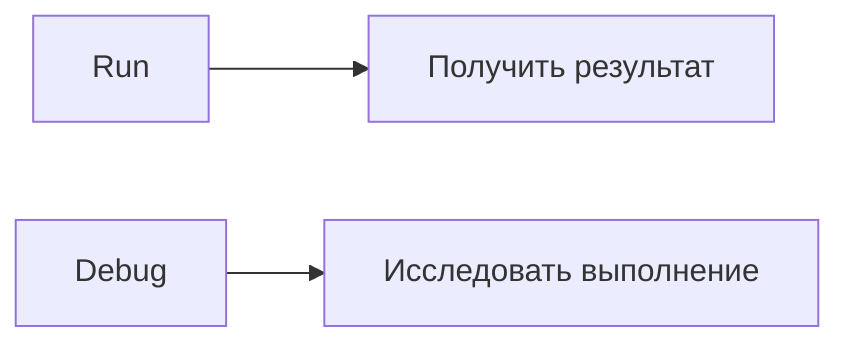

---

# 18. Главный вопрос отладки

Самый полезный вопрос:

> **После какой строки состояние программы впервые стало не таким, как мы ожидали?**

Не нужно сразу угадывать исправление.

Сначала найдите **первое расхождение**.

Например, ожидали:

```text
result:
0
10
30
60
```

а увидели:

```text
result:
0
10
20
30
```

Это уже сильная подсказка.

---

# 19. Breakpoint

**Breakpoint** — точка, в которой дебаггер временно останавливает выполнение программы.

Обычно breakpoint ставится кликом рядом с номером строки.

Например:

```java
for (int number : numbers) {
result = number; // breakpoint
}
```

После запуска через `Debug` программа остановится на этой строке.

---

# 20. Важная модель breakpoint

Остановка происходит **перед выполнением выделенной строки**.

Предположим:

```java
int result = 10;
result = result + 5;
```

Breakpoint стоит на второй строке:

```java
result = result + 5;
```

Во время остановки значение:

```text
result = 10
```

Потому что строка `result = result + 5` ещё не выполнена.

После шага значение станет:

```text
result = 15
```

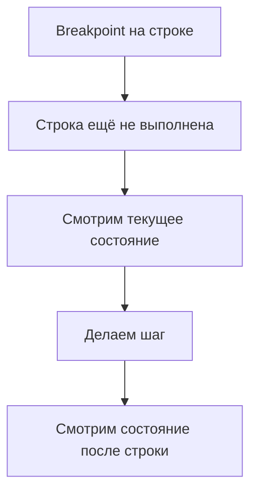

Это одно из самых важных правил при работе с дебаггером.

---

# 21. Breakpoint внутри цикла

Рассмотрим:

```java
int result = 0;

for (int number : numbers) {
result += number;
}
```

Если breakpoint поставить внутри цикла, программа будет приходить к нему на каждой итерации.

Для:

```java
int[] numbers = {10, 20, 30};
```

можно наблюдать:

| Итерация | `number` | `result` до строки |
|---:|---:|---:|
| 1 | 10 | 0 |
| 2 | 20 | 10 |
| 3 | 30 | 30 |

После выполнения строки на третьей итерации:

```text
result = 60
```

---

# 22. Окно Variables

При остановке IntelliJ IDEA показывает локальные переменные текущего метода.

Например:

```text
numbers
result
number
```

Для массива можно раскрыть значение и увидеть элементы:

```text
numbers
  [0] = 10
  [1] = 20
  [2] = 30
```

Главная привычка:

> Не смотрите на все переменные подряд. Сначала определите, какие значения важны для проверяемого алгоритма.

---

# 23. Сначала ожидание — потом фактическое значение

Перед шагом полезно спросить себя:

> Что должно произойти после этой строки?

Например:

```java
result += number;
```

Сейчас:

```text
result = 10
number = 20
```

Ожидаем после выполнения:

```text
result = 30
```

Делаем шаг.

Если видим:

```text
result = 30
```

гипотеза подтверждена.

Если видим другое значение — нашли важное место.

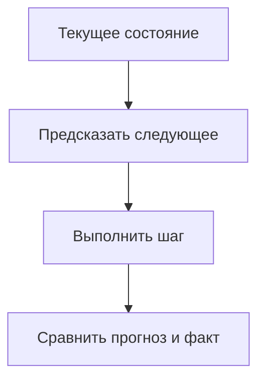

---

# 24. Step Over

`Step Over` выполняет текущую строку и останавливается на следующей строке текущего уровня.

Например:

```java
int total = sum(numbers);
System.out.println(total);
```

Если остановились на:

```java
int total = sum(numbers);
```

и нажали `Step Over`, дебаггер выполнит весь `sum(...)` как одну операцию с вашей точки зрения.

Следующая остановка будет примерно на:

```java
System.out.println(total);
```

Используйте `Step Over`, когда:

- вызванный метод сейчас не интересен;
- вы доверяете его работе;
- хотите исследовать текущий метод.

---

# 25. Step Into

`Step Into` позволяет зайти внутрь вызываемого метода.

Есть:

```java
int total = sum(numbers);
```

Если выбрать `Step Into`, дебаггер перейдёт внутрь:

```java
public static int sum(int[] numbers) {
    int result = 0;
    ...
}
```

Теперь можно проверить:

- какой массив пришёл;
- чему равны параметры;
- как работает цикл;
- где появляется неправильное значение.

---

# 26. Step Out

Предположим, вы зашли в метод:

```java
sum(...)
```

и уже поняли, что внутри всё нормально.

Необязательно вручную проходить оставшиеся строки.

`Step Out`:

- выполняет оставшуюся часть текущего метода;
- возвращает выполнение в вызывающий код.

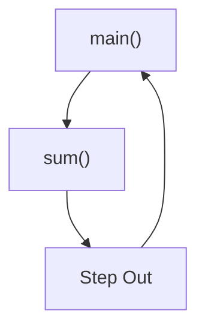

---

# 27. Resume Program

`Resume Program` продолжает выполнение программы без пошаговой остановки.

Она будет выполняться:

- до следующего breakpoint;
- либо до завершения программы.

Это особенно полезно с breakpoint внутри цикла.

Можно:

1. остановиться на первой итерации;
2. посмотреть значения;
3. нажать `Resume`;
4. остановиться на следующей итерации;
5. снова посмотреть состояние.

---

# 28. Step Over / Step Into / Step Out / Resume

| Команда | Смысл |
|---|---|
| `Step Over` | выполнить строку, не исследуя вызванный метод |
| `Step Into` | зайти внутрь вызываемого метода |
| `Step Out` | закончить текущий метод и вернуться наружу |
| `Resume Program` | продолжить до следующей остановки |

Главный вопрос выбора:

> **Какой участок кода я сейчас исследую?**

---

# 29. Сквозной пример: программа работает неправильно

Возьмём метод:

```java
public static int sum(int[] numbers) {
    int result = 0;

    for (int number : numbers) {
        result = number;
    }

    return result;
}
```

Вызов:

```java
int[] numbers = {10, 20, 30};

System.out.println(sum(numbers));
```

Ожидаемый результат:

```text
60
```

Фактический:

```text
30
```

Компиляция успешна.

Программа завершается нормально.

Значит перед нами **логическая ошибка**.

---

# 30. Не исправляем сразу

Даже если вы уже заметили ошибку глазами, полезно один раз пройти её дебаггером.

Это позволит понять сам процесс диагностики.

Сначала сформулируем ожидаемое состояние:

| После обработки элемента | Ожидаемый `result` |
|---:|---:|
| начало | 0 |
| 10 | 10 |
| 20 | 30 |
| 30 | 60 |

---

# 31. Ставим breakpoint

Поставим breakpoint на:

```java
result = number;
```

Запускаем программу в `Debug`.

На первой остановке:

```text
number = 10
result = 0
```

Строка ещё не выполнена.

---

# 32. Первая итерация

Перед строкой:

```java
result = number;
```

видим:

```text
number = 10
result = 0
```

После `Step Over`:

```text
result = 10
```

Пока результат совпадает с ожиданием.

---

# 33. Вторая итерация

Следующая остановка:

```text
number = 20
result = 10
```

Что должно произойти?

Если считаем сумму:

```text
10 + 20 = 30
```

Ожидаем:

```text
result = 30
```

Но выполняется:

```java
result = number;
```

После шага:

```text
result = 20
```

Вот первое расхождение.

---

# 34. Первое неправильное состояние

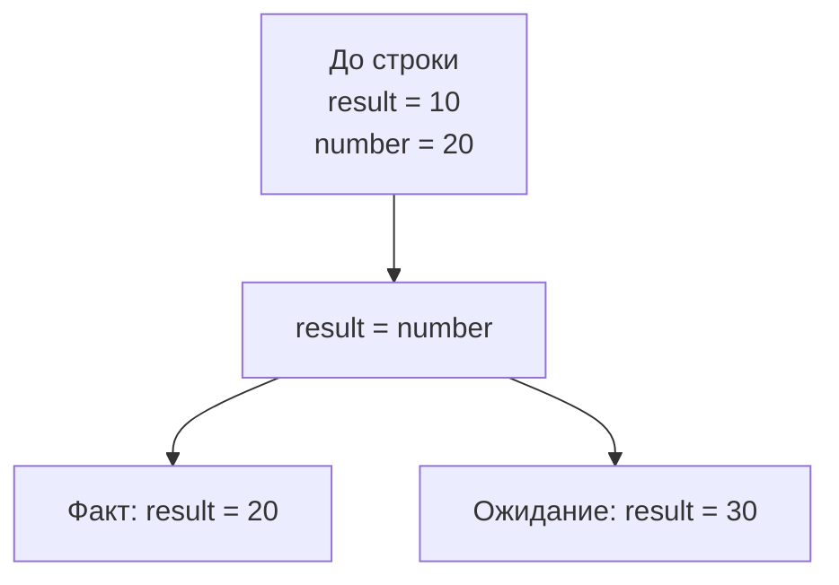

Мы нашли не просто неправильный финальный ответ.

Мы нашли:

> **первую строку, после которой состояние стало неправильным.**

---

# 35. Причина ошибки

Текущий код:

```java
result = number;
```

означает:

> заменить старое значение `result` текущим `number`.

Но алгоритму суммы нужно:

```text
старый result
+
текущий number
```

Исправление:

```java
result += number;
```

---

# 36. Повторная проверка

После исправления снова запускаем:

```java
int[] numbers = {10, 20, 30};
```

Результат:

```text
60
```

Но проверка не должна останавливаться на одном примере.

Например:

```java
int[] numbers = {1, 2, 3};
```

Ожидаем:

```text
6
```

И:

```java
int[] numbers = {10};
```

Ожидаем:

```text
10
```

---

# 37. Call Stack — стек вызовов

Когда один метод вызывает другой, можно представить цепочку вызовов.

Например:

```java
public static void main(String[] args) {
    printSum(new int[]{10, 20, 30});
}

public static void printSum(int[] numbers) {
    int result = sum(numbers);
    System.out.println(result);
}

public static int sum(int[] numbers) {
    ...
}
```

Во время выполнения `sum()` цепочка выглядит так:

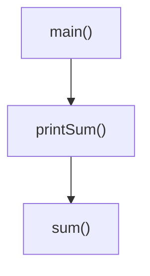

Текущий метод:

```text
sum()
```

Но попасть в него программа смогла через:

```text
main()
→ printSum()
→ sum()
```

---

# 38. Что показывает Call Stack

Стек вызовов отвечает на вопрос:

> **Как программа пришла в текущую точку?**

Например:

```text
sum
printSum
main
```

Это особенно полезно, когда один и тот же метод может вызываться из разных мест.

---

# 39. Step Into и Call Stack

Стоим в:

```java
int result = sum(numbers);
```

Нажимаем `Step Into`.

Переходим в:

```java
sum(...)
```

В стеке появляется новый активный вызов.

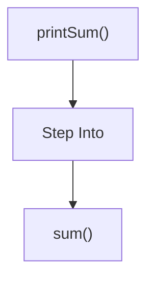

---

# 40. Step Out и Call Stack

Находимся внутри:

```text
sum()
```

Нажимаем `Step Out`.

Метод завершается.

Возвращаемся в:

```text
printSum()
```

Стек снова становится короче.

---

# 41. Как выбирать место для breakpoint

Плохая стратегия:

> Поставлю breakpoint на первую строку `main` и буду идти по всей программе.

Это может сработать на пяти строках.

Но на реальной программе быстро становится неудобно.

Лучше сначала определить:

> Где примерно находится участок, который влияет на неправильный результат?

Например, неправильно считается среднее.

Значит интересен метод:

```java
average(...)
```

И breakpoint логичнее ставить внутри него.

---

# 42. Алгоритм диагностики логической ошибки

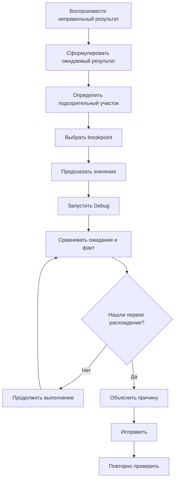

---

# 43. Самостоятельная задача: неправильное среднее

Рассмотрим:

```java
public static double average(int[] numbers) {
    int sum = 0;

    for (int number : numbers) {
        sum += number;
    }

    return sum / numbers.length;
}
```

Вызов:

```java
int[] numbers = {1, 2};

System.out.println(average(numbers));
```

Ожидаем:

```text
1.5
```

Получаем:

```text
1.0
```

---

# 44. Не смотрите сразу на ответ

Попробуйте пройти полноценный цикл.

## Шаг 1

Запустите программу через `Run`.

Зафиксируйте:

```text
ожидание = 1.5
факт = 1.0
```

## Шаг 2

Поставьте breakpoint перед:

```java
return sum / numbers.length;
```

## Шаг 3

Запустите через `Debug`.

Проверьте:

```text
sum
numbers.length
```

Должно быть:

```text
sum = 3
numbers.length = 2
```

До этого места алгоритм работает правильно.

---

# 45. Где появляется проблема

Остаётся выражение:

```java
sum / numbers.length
```

Подставим значения:

```text
3 / 2
```

Оба операнда имеют тип:

```text
int
```

Значит выполняется целочисленное деление:

```text
3 / 2 = 1
```

И только потом `1` преобразуется в:

```text
1.0
```

---

# 46. Исправление среднего

Один из вариантов:

```java
return (double) sum / numbers.length;
```

Теперь:

```text
3.0 / 2
```

даёт:

```text
1.5
```

---

# 47. Проверяем исправление

Проверьте минимум несколько наборов.

```java
average(new int[]{1, 2})
```

Ожидаем:

```text
1.5
```

```java
average(new int[]{2, 4})
```

Ожидаем:

```text
3.0
```

```java
average(new int[]{5})
```

Ожидаем:

```text
5.0
```

Дебаггер помог найти причину.

Но правильность после исправления всё равно подтверждается проверками.

---

# 48. Run и Debug — не конкуренты

Не нужно запускать каждую программу через Debug.

Обычный рабочий цикл:

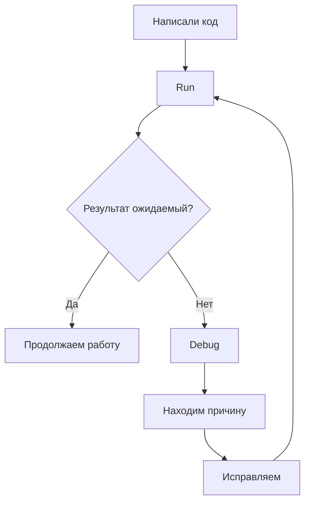

---

# 49. Частая ошибка: идти по каждой строке

Дебаггер не предназначен для того, чтобы механически нажимать `Step Over` сотни раз.

Перед отладкой сформулируйте гипотезу:

```text
Неправильно считается сумма?
Неверно работает условие?
Ошибка появляется на определённой итерации?
Метод получает неправильный аргумент?
```

Тогда выбирайте breakpoint.

---

# 50. Частая ошибка: смотреть только на финальный результат

Если программа должна вернуть:

```text
60
```

а возвращает:

```text
30
```

мы уже знаем, что финал неправильный.

Поэтому во время Debug интереснее искать:

> Когда именно значения впервые начали расходиться?

---

# 51. Частая ошибка: не учитывать момент остановки

Если breakpoint стоит на:

```java
result += number;
```

то при остановке эта строка **ещё не выполнилась**.

Не делайте вывод:

> «Почему `result` ещё не увеличился? Дебаггер сломан».

Сделайте `Step Over` и посмотрите состояние после строки.

---

# 52. Частая ошибка: Step Into везде

Если постоянно использовать `Step Into`, можно попасть во множество методов, которые сейчас не относятся к вашей задаче.

Используйте его только тогда, когда хотите исследовать конкретный вызов.

Если метод сейчас не интересен:

```text
Step Over
```

обычно удобнее.

---

# 53. Частая ошибка: breakpoint слишком далеко от проблемы

Если неправильный результат формируется в:

```java
average(...)
```

необязательно начинать отладку с первой строки `main`.

Ставьте breakpoint ближе к месту, где:

- вычисляется интересующий результат;
- меняется важная переменная;
- проверяется важное условие.

---

# 54. Stop — остановить программу

Иногда программа не завершается.

Например:

```java
while (true) {
        System.out.println("Working...");
}
```

Или из-за ошибки условие цикла никогда не становится `false`.

В IntelliJ IDEA выполнение можно остановить через:

```text
Stop
```

Это не то же самое, что breakpoint.

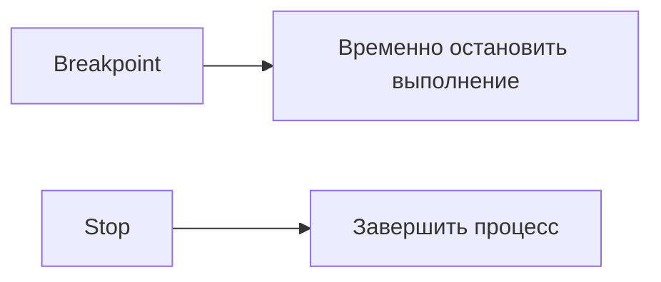

---

# 55. Если breakpoint не срабатывает

Проверьте несколько вещей.

## Запустили ли вы `Debug`, а не `Run`?

Breakpoint используется дебаггером.

## Выполняется ли вообще эта строка?

Например:

```java
if (false) {
        System.out.println("Hello");
}
```

Breakpoint внутри блока никогда не будет достигнут.

## На исполняемой ли строке стоит breakpoint?

Не каждая строка исходного файла соответствует отдельному исполняемому действию.

## Запускаете ли вы тот код, который редактируете?

В проекте может быть несколько классов с `main`.

---

# 56. Если значения выглядят странно

Проверяйте:

- на какой итерации вы находитесь;
- была ли текущая строка уже выполнена;
- в каком методе вы находитесь;
- какие значения были переданы в параметры;
- не перезаписывается ли переменная позже.

Не пытайтесь одновременно отслеживать всё.

Выберите 1–3 ключевых значения.

---

# 57. Debug начинается до запуска

Хорошая отладка начинается не с кнопки `Debug`.

Она начинается с вопроса:

> Что я ожидаю увидеть?

Например:

```text
Итерация 1:
number = 10
result после строки = 10

Итерация 2:
number = 20
result после строки = 30

Итерация 3:
number = 30
result после строки = 60
```

Теперь дебаггер превращается в инструмент проверки гипотезы.

---

# 58. Мини-практика: ошибка в максимуме

Попробуйте самостоятельно отладить:

```java
public static int max(int[] numbers) {
    int max = 0;

    for (int number : numbers) {
        if (number > max) {
            max = number;
        }
    }

    return max;
}
```

Для:

```java
int[] numbers = {-10, -3, -20};
```

метод возвращает:

```text
0
```

Но такого значения в массиве даже нет.

Перед исправлением:

1. сформулируйте ожидаемый результат;
2. выберите breakpoint;
3. пройдите цикл;
4. найдите первое неверное состояние;
5. объясните причину.

---

# 59. Подсказка к задаче про максимум

Посмотрите на начальное состояние:

```java
int max = 0;
```

Задайте вопрос:

> Гарантировано ли, что `0` является допустимой начальной оценкой максимума для любого `int[]`?

Для массива:

```text
-10, -3, -20
```

ответ — нет.

Это хороший пример того, что ошибка может находиться **до цикла**, а проявляться только после его завершения.

---

# 60. Ещё одна практика: счётчик

```java
public static int countPositive(int[] numbers) {
    int count = 0;

    for (int number : numbers) {
        if (number >= 0) {
            count++;
        }
    }

    return count;
}
```

Проверьте на:

```java
int[] numbers = {-2, 0, 5};
```

Если по условию нужно считать только **строго положительные** числа, ожидаем:

```text
1
```

Программа вернёт:

```text
2
```

Найдите итерацию, на которой счётчик впервые становится неправильным.

---

# 61. Навигация + Debug как один процесс

Представьте, что вы увидели в `main`:

```java
double result = average(numbers);
```

Рабочий процесс:

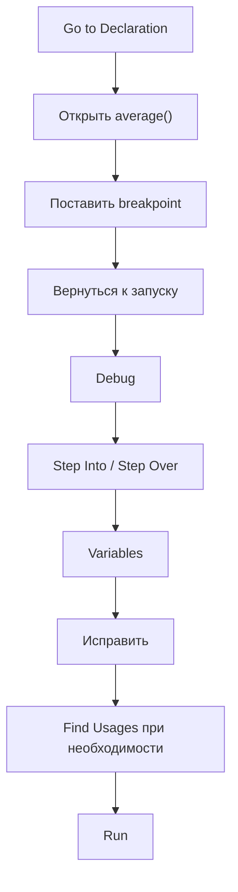

IDE-инструменты не существуют отдельно друг от друга.

Они поддерживают один рабочий цикл.

---

# 62. Rename + Find Usages

Допустим:

```java
public static double avg(int[] numbers)
```

Хотим более понятное имя:

```java
public static double average(int[] numbers)
```

Перед изменением можно:

1. посмотреть `Find Usages`;
2. выполнить `Rename`;
3. убедиться, что все вызовы обновились.

Это безопаснее ручной замены текста.

---

# 63. Отладка метода с параметрами

Метод:

```java
public static int countGreaterThan(
        int[] numbers,
        int threshold
) {
    int count = 0;

    for (int number : numbers) {
        if (number > threshold) {
            count++;
        }
    }

    return count;
}
```

При входе через `Step Into` особенно полезно сразу проверить:

```text
numbers
threshold
```

Возможно, метод работает правильно, а неправильный аргумент был передан из вызывающего кода.

---

# 64. Ошибка может быть не внутри метода

Например:

```java
int result = countGreaterThan(numbers, 100);
```

Вы ожидали считать числа больше `10`.

Сам метод работает абсолютно правильно.

Ошибка находится здесь:

```text
передан threshold = 100
вместо threshold = 10
```

Поэтому при отладке важно проверять не только локальный алгоритм, но и параметры вызова.

---

# 65. Call Stack помогает понять источник данных

Если метод получил неправильный параметр:

```text
threshold = 100
```

Call Stack показывает:

> Кто вызвал этот метод?

Можно перейти к вызывающему коду и проверить, откуда взялось значение `100`.

---

# 66. Watches — дополнительный инструмент

Этот раздел необязательный.

`Watches` позволяют закрепить интересующее выражение и наблюдать за ним во время отладки.

Например:

```text
result + number
```

или:

```text
sum / numbers.length
```

Это удобно, когда одно выражение нужно проверять на нескольких шагах.

Но для большинства задач первых недель достаточно окна `Variables`.

---

# 67. Evaluate Expression — дополнительный инструмент

Во время остановки можно разово вычислить выражение.

Например, сейчас:

```text
sum = 3
numbers.length = 2
```

Можно проверить:

```java
(double) sum / numbers.length
```

и увидеть:

```text
1.5
```

Это удобно для проверки гипотезы без изменения исходного кода.

---

# 68. Когда не нужен дебаггер

Не всякая проблема требует Debug.

Например:

```java
int age = "18";
```

IDE и компилятор уже сообщают о типовой ошибке.

Или:

```java
System.out.println("Hello")
```

без `;`.

Это ошибка компиляции.

Сначала нужно прочитать сообщение IDE.

Дебаггер не заменяет компилятор.

---

# 69. Когда дебаггер особенно полезен

Используйте Debug, если:

- программа запускается, но результат неверный;
- непонятно, как меняется переменная в цикле;
- метод получает неожиданный параметр;
- условие срабатывает не тогда, когда ожидалось;
- значение перезаписывается;
- нужно понять цепочку вызовов методов.

---

# 70. Рабочая памятка

Если программа работает неправильно:

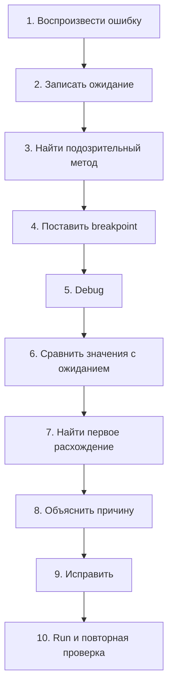

---

# 71. Что нужно уметь после материала

Проверьте себя.

Вы должны уметь без пошаговой инструкции:

- открыть проект целиком;
- найти `Main.java` и другой Java-файл;
- пользоваться `Project`, `Editor`, `Run`, `Debug`;
- использовать автодополнение;
- применить `Reformat Code`;
- отличить ошибку от warning;
- прочитать сообщение IDE;
- использовать простой Quick Fix с пониманием результата;
- найти класс через `Search Everywhere`;
- перейти к объявлению метода;
- найти использования;
- безопасно переименовать переменную или метод;
- запустить и остановить программу;
- объяснить, почему `exit code 0` не означает правильность;
- поставить и удалить breakpoint;
- объяснить, что breakpoint останавливает программу до выполнения строки;
- использовать `Step Over`;
- использовать `Step Into`;
- использовать `Step Out`;
- использовать `Resume Program`;
- смотреть локальные переменные;
- раскрывать массив;
- читать простой Call Stack;
- находить первое неправильное состояние программы;
- исправлять ошибку и проверять исправление.

---

# 72. Финальная модель

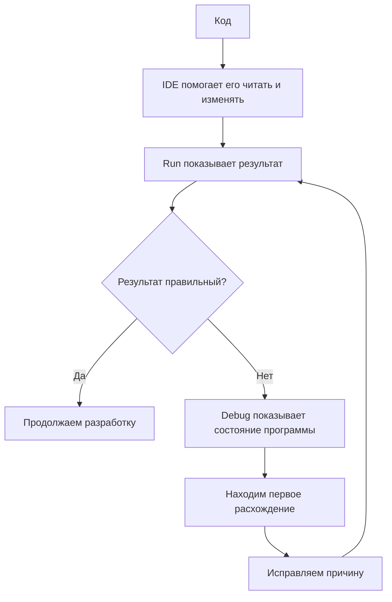

Главная мысль:

> **Не угадывайте причину ошибки. Сформулируйте ожидание, наблюдайте состояние программы и найдите первое место, где факт расходится с ожиданием.**

---

# Практика для самостоятельной проверки

## Задача 1. Сумма массива

Найдите и исправьте ошибку:

```java
public static int sum(int[] numbers) {
    int result = 0;

    for (int number : numbers) {
        result = number;
    }

    return result;
}
```

Проверка:

```java
int[] numbers = {10, 20, 30};
```

Ожидается:

```text
60
```

---

## Задача 2. Среднее

Найдите и исправьте ошибку:

```java
public static double average(int[] numbers) {
    int sum = 0;

    for (int number : numbers) {
        sum += number;
    }

    return sum / numbers.length;
}
```

Проверка:

```java
int[] numbers = {1, 2};
```

Ожидается:

```text
1.5
```

---

## Задача 3. Максимум

Найдите и исправьте ошибку:

```java
public static int max(int[] numbers) {
    int max = 0;

    for (int number : numbers) {
        if (number > max) {
            max = number;
        }
    }

    return max;
}
```

Проверка:

```java
int[] numbers = {-10, -3, -20};
```

Ожидается:

```text
-3
```

---

## Задача 4. Положительные числа

Найдите и исправьте ошибку:

```java
public static int countPositive(int[] numbers) {
    int count = 0;

    for (int number : numbers) {
        if (number >= 0) {
            count++;
        }
    }

    return count;
}
```

Проверка:

```java
int[] numbers = {-2, 0, 5};
```

Если считаются только строго положительные числа, ожидается:

```text
1
```

---

# Мини-чек-лист диагностики

Перед тем как просить помощь, попробуйте ответить на пять вопросов:

1. Какой результат я ожидал?
2. Какой результат получил?
3. Какой метод отвечает за этот результат?
4. Какие значения должны меняться внутри него?
5. После какой строки фактическое значение впервые отличается от ожидаемого?

Если вы можете ответить на эти вопросы, вы уже не просто «ищете баг», а **системно отлаживаете программу**.
