# Java 1. Неделя 3 — Семинар №2. Устройство памяти в Java

На предыдущих занятиях уже появились методы, массивы, строки, классы и объекты. Мы умеем написать метод, передать ему аргументы, создать объект через `new`, сохранить ссылку в переменную и вызвать метод объекта. Но до сих пор большая часть того, **как JVM хранит состояние программы во время выполнения**, оставалась невидимой.

На этом семинаре добавляется модель размещения данных в памяти. Она нужна не ради устройства JVM само по себе, а чтобы объяснить обычное поведение Java-кода.

Например, почему после завершения метода его локальные переменные исчезают, а созданный внутри объект иногда продолжает существовать? Почему две переменные могут «видеть» изменения одного объекта? Что именно копируется при присваивании объектной переменной? Почему один код заканчивается `StackOverflowError`, другой — `NullPointerException`, а третий — `OutOfMemoryError`?

Все эти вопросы связывает одна модель:

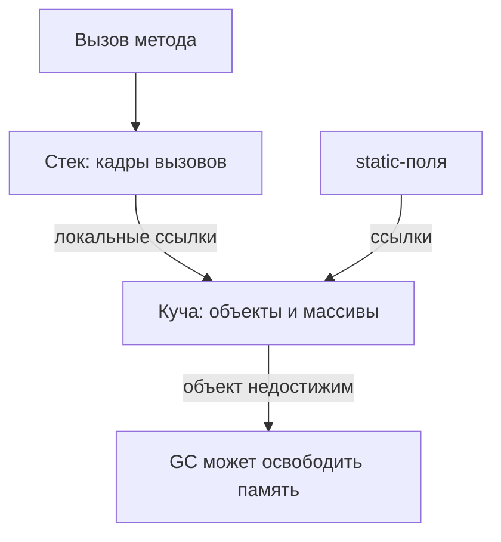

В рамках семинара используется учебная модель. Мы не будем подробно разбирать JIT-компиляцию, внутреннее устройство объектных заголовков, конкретные алгоритмы современных сборщиков мусора или десятки JVM-флагов. Цель — понять достаточно, чтобы уверенно читать и объяснять поведение обычной Java-программы.

---

# 1. Зачем нужна модель памяти

До этой темы можно было рассматривать программу почти только на уровне исходного кода.

Мы видели:

```java
int total = sum(2, 3);
```

и знали: метод `sum` получает аргументы, вычисляет результат и возвращает его.

Мы видели:

```java
Product product = new Product("Лопатка");
```

и знали: создаётся объект.

Мы видели:

```java
Product second = product;
```

и уже знаем из объектной модели: две переменные могут относиться к одному объекту.

Но теперь возникает дополнительный вопрос: **где хранится всё это состояние, пока программа работает?**

Метод должен где-то хранить свои параметры и локальные переменные. Если он вызывает другой метод, состояние первого вызова нельзя потерять: после завершения второго нужно продолжить с того же места.

Объекты ведут себя иначе. Объект может пережить вызов метода, внутри которого был создан. Значит, время жизни объекта нельзя полностью связать с временем жизни одного вызова.

Отсюда появляется первое важное разделение:

```text
стек
→ состояние активных вызовов методов

куча
→ объекты и массивы
```

Эта модель упрощённая, но именно она позволяет связать методы, ссылки и объекты в одну картину.

---

# 2. Карта памяти: стек и куча

Начнём с общей схемы.

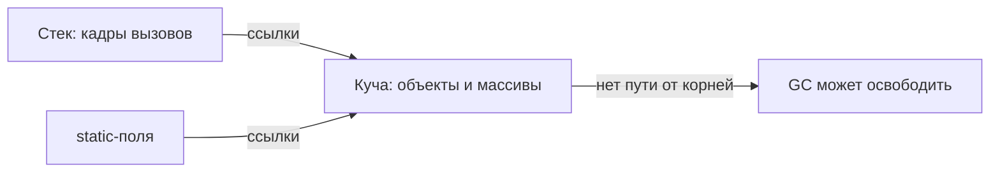

В этой схеме три основные идеи.

Первая — **стек вызовов (`call stack`)**. Он содержит кадры работающих методов. В кадре находятся параметры и локальные переменные конкретного вызова.

Вторая — **куча (`heap`)**. В ней находятся объекты и массивы.

Третья — ссылки. Локальная переменная объектного типа может находиться в кадре стека, а сам объект, на который она указывает, находится в куче.

Например, строку:

```java
Product product = new Product("Лопатка");
```

полезно мысленно разделять:

```text
product
→ локальная переменная
→ хранит ссылку

new Product(...)
→ создаёт объект в куче
```

Переменная и объект — не одно и то же. Это различие станет основой почти всех следующих примеров.

---

# 3. Стек вызовов

## 3.1. Знакомая цепочка методов

На неделе методов уже встречалась цепочка:

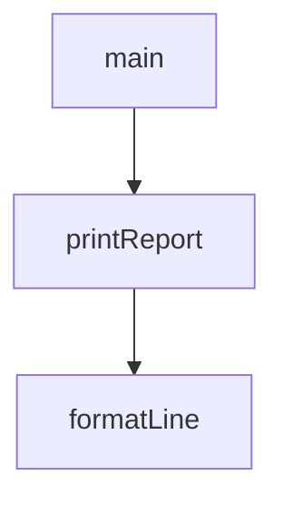

`main` вызывает `printReport`, а `printReport` вызывает `formatLine`.

С точки зрения исходного кода это просто переходы между методами. Но JVM должна сохранить состояние каждого незавершённого вызова.

Когда `main` вызывает `printReport`, `main` ещё не закончен. После `printReport` выполнение должно вернуться обратно в `main`.

Когда `printReport` вызывает `formatLine`, сам `printReport` тоже ещё не закончен. Значит, его состояние тоже нужно сохранить.

Вызовы наслаиваются:

```text
сначала:
main

затем:
printReport
main

затем:
formatLine
printReport
main
```

Завершаются они в обратном порядке:

```text
formatLine
↓
printReport
↓
main
```

Это и есть стековый принцип: последний добавленный вызов завершается первым.

Иногда встречается термин LIFO — *Last In, First Out*. Запоминать английскую аббревиатуру менее важно, чем понимать саму механику: верхний вызов должен закончиться, прежде чем продолжит работу вызвавший его метод.

---

## 3.2. Кадр вызова

У каждого вызова есть собственное состояние.

Рассмотрим:

```java
public static void main(String[] args) {
    int total = sum(2, 3);
    System.out.println(total);
}

static int sum(int a, int b) {
    int result = a + b;
    return result;
}
```

Во время работы `sum` существуют:

- параметр `a`;
- параметр `b`;
- локальная переменная `result`.

Состояние одного вызова метода называется **кадром (`stack frame`)**.

Перед `return` можно представить состояние так:

```text
кадр sum:
a = 2
b = 3
result = 5

кадр main:
args = ...
total ещё не присвоено
```

Почему `total` ещё не равен `5`? Потому что выражение `sum(2, 3)` ещё не закончило выполнение. Сначала вызванный метод должен вернуть результат.

Пошагово:

```text
main начинает:
int total = sum(2, 3);

↓

создаётся кадр sum

a = 2
b = 3

↓

result = a + b

↓

result = 5

↓

return 5

↓

кадр sum уничтожается

↓

total = 5 в кадре main
```

Ключевой момент: кадр относится не к методу «вообще», а к **конкретному вызову**.

Если метод вызвать два раза, будут два отдельных состояния.

---

## 3.3. Два вызова одного метода

Рассмотрим:

```java
static int doubleValue(int number) {
    int result = number * 2;
    return result;
}

public static void main(String[] args) {
    int first = doubleValue(10);
    int second = doubleValue(20);
}
```

Первый вызов получает:

```text
number = 10
result = 20
```

После `return` его кадр исчезает.

Затем создаётся новый кадр:

```text
number = 20
result = 40
```

Это не одна переменная `number`, которая «переиспользовалась» в логическом смысле. Это два разных состояния двух последовательных вызовов.

Именно эта модель объясняет, почему один метод можно вызывать снова и снова с разными аргументами.

---

## 3.4. Примитивы в кадре

В примере:

```java
static int sum(int a, int b) {
    int result = a + b;
    return result;
}
```

`a`, `b` и `result` имеют тип `int`.

В нашей учебной модели локальная переменная примитивного типа хранит непосредственно значение:

```text
a = 2
b = 3
result = 5
```

То есть для локального `int result = 5` не нужен отдельный объект с числом `5`, на который ведёт ссылка.

Контраст с объектными переменными появится дальше.

---

## 3.5. Что происходит после return

После:

```java
return result;
```

вызов `sum` завершён.

Его кадр удаляется из стека целиком.

До `return`:

```text
sum:
a = 2
b = 3
result = 5

main:
total ещё не присвоено
```

После `return`:

```text
main:
total = 5
```

Параметров `a`, `b` и переменной `result` этого вызова больше нет.

Так модель стека дополняет уже знакомое понятие области видимости: локальная переменная не просто «не видна» вне метода — её состояние связано с конкретным кадром, который существует только пока выполняется этот вызов.

---

## 3.6. Стек в отладчике IDEA

Стек можно увидеть во время отладки.

Если поставить breakpoint внутри `sum`, полезны два окна:

- `Frames`;
- `Variables`.

`Frames` показывает цепочку активных вызовов. Например:

```text
sum
main
```

`Variables` показывает параметры и локальные переменные выбранного кадра.

Для `sum` можно увидеть:

```text
a = 2
b = 3
result = 5
```

Если выбрать кадр `main`, отладчик покажет уже состояние `main`.

Важно: переключение между кадрами в debugger не откатывает программу назад. Меняется только то, **какой кадр мы сейчас рассматриваем**.

---

# 4. Когда стек заканчивается

Каждый новый вызов создаёт новый кадр. Кадр исчезает только после завершения своего вызова.

Рассмотрим метод:

```java
static int countdown(int value) {
    return countdown(value - 1);
}
```

Он вызывает сам себя.

Если вызвать:

```java
countdown(10);
```

первый вызов получает `value = 10`, но для завершения ему нужен результат `countdown(9)`.

Тот, в свою очередь, ждёт `countdown(8)`.

Получается:

```text
countdown(10)
↓
countdown(9)
↓
countdown(8)
↓
countdown(7)
↓
...
```

Старые вызовы пока не могут завершиться. Поэтому их кадры остаются в стеке.

Стек растёт:

```text
countdown(...)
countdown(...)
countdown(...)
countdown(...)
main
```

---

## 4.1. StackOverflowError

Стек имеет ограниченный размер.

Если новые кадры продолжают появляться, а старые не удаляются, JVM в какой-то момент не сможет разместить следующий кадр.

Возникает:

```text
java.lang.StackOverflowError
```

В stack trace часто видно много одинаковых строк:

```text
java.lang.StackOverflowError
    at Main.countdown(Main.java:4)
    at Main.countdown(Main.java:4)
    at Main.countdown(Main.java:4)
    at Main.countdown(Main.java:4)
    ...
```

Это важная диагностическая подсказка: один и тот же метод снова и снова вызывает себя.

Самовызов метода называется рекурсией. Здесь рекурсивные алгоритмы подробно не изучаются. Для темы памяти достаточно одной мысли:

> Рекурсивный вызов — обычный вызов метода, поэтому он тоже создаёт новый кадр.

Без условия остановки глубина вызовов растёт до `StackOverflowError`.

---

## 4.2. Почему нельзя запомнить «стек равен N вызовам»

Иногда хочется спросить: сколько именно кадров помещается в стек?

Можно поставить счётчик:

```java
static int depth = 0;

static int countdown(int value) {
    depth++;

    if (depth % 1000 == 0) {
        System.out.println(depth);
    }

    return countdown(value - 1);
}
```

Консоль может показать:

```text
1000
2000
3000
...
java.lang.StackOverflowError
```

Последнее число даёт лишь примерную глубину для конкретного запуска.

Размер кадра зависит от метода, а размер стека — от настроек JVM и среды запуска. Поэтому нет полезного универсального числа «в Java помещается столько-то вызовов».

Нужно запомнить механизм:

```text
каждый вызов
→ новый кадр

слишком много одновременно активных кадров
→ StackOverflowError
```

---

# 5. От стека к куче

До сих пор картина проста: метод вызван — кадр появился; метод завершён — кадр исчез.

Но теперь рассмотрим другой пример:

```java
static Product createDefault() {
    return new Product("Лопатка");
}

public static void main(String[] args) {
    Product product = createDefault();
}
```

Метод `createDefault` создаёт объект и возвращает его.

После `return` кадр `createDefault` уничтожается. Но объект продолжает существовать, потому что переменная `product` в `main` всё ещё может с ним работать.

Значит, объект не мог храниться только внутри кадра `createDefault`.

Именно здесь появляется вторая часть модели — **куча (`heap`)**.

---

# 6. Куча: место для объектов и массивов

В учебной модели:

```text
стек
→ кадры вызовов
→ параметры
→ локальные переменные

куча
→ объекты
→ массивы
```

Рассмотрим:

```java
Product product = new Product("Лопатка");
```

Удобно представить выполнение так:

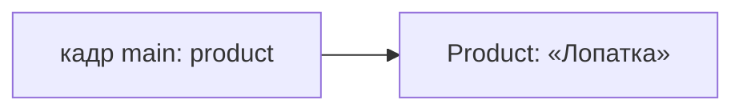

Локальная переменная `product` относится к кадру `main`.

Сам объект `Product` находится отдельно в куче.

Это различие объясняет, почему объект может пережить метод, в котором появился.

Метод может закончиться, его кадр исчезнет, но если другая ссылка по-прежнему ведёт к объекту, объект остаётся достижимым.

---

# 7. Ссылка и объект — разные вещи

Это одна из главных идей темы.

Рассмотрим снова:

```java
Product product = new Product("Лопатка");
```

Здесь есть три разные сущности:

1. локальная переменная `product`;
2. значение ссылки, хранящееся в этой переменной;
3. сам объект `Product`.

Упрощённая модель:

```text
product
↓
ссылка
↓
объект Product
```

Ссылку не нужно представлять как настоящий числовой адрес памяти. На этом уровне достаточно понимать её как значение, через которое программа может добраться до объекта.

---

## 7.1. Две ссылки на один объект

Рассмотрим:

```java
Product original = new Product("Лопатка снеговая");
Product same = original;
```

В первой строке есть `new`, значит, создаётся объект.

Во второй строке `new` нет.

```java
same = original;
```

копирует значение переменной `original`.

Но значение объектной переменной — ссылка.

Поэтому копируется именно ссылка.

Получаем:

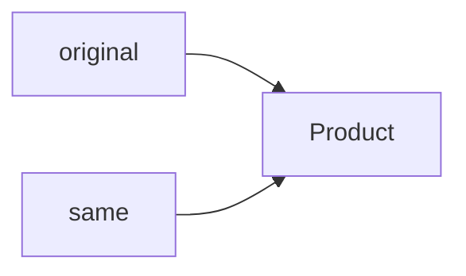

Переменных две, объект один.

---

## 7.2. Почему изменение видно через обе ссылки

Предположим, у товара есть цена.

```java
Product original = new Product("Лопатка снеговая");
original.setPrice(1000);

Product same = original;
same.setPrice(500);

System.out.println(original.getPrice());
```

Результат:

```text
500
```

Причина не в том, что Java «синхронизировала» две переменные.

Причина проще:

```text
original
→ один объект

same
→ тот же объект
```

`same.setPrice(500)` меняет сам объект.

Затем `original.getPrice()` обращается к тому же объекту и видит новое состояние.

---

## 7.3. Как создать другой объект

Чтобы получить другой объект, нужен новый вызов `new`:

```java
Product first = new Product("Лопатка");
Product second = new Product("Лопатка");
```

Теперь объектов два:

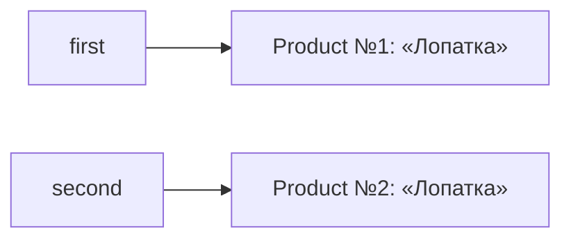

Даже если значения полей совпадают, сами объекты разные.

Главный контраст:

```text
same = original
→ копирование ссылки

new Product(...)
→ создание нового объекта
```

---

# 8. Массив — тоже объект

Куча используется не только для экземпляров собственных классов.

Массивы тоже являются объектами.

Например:

```java
int[] amounts = new int[3];
```

Переменная `amounts` хранит ссылку, а сам массив находится в куче.

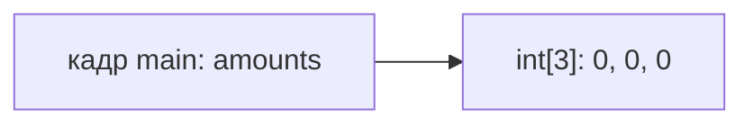

После создания:

```text
amounts.length = 3
```

а элементы типа `int` имеют начальное значение `0`.

Если написать:

```java
int[] same = amounts;
```

новый массив не появится.

Получатся две ссылки на один массив.

Поэтому:

```java
same[0] = 100;
System.out.println(amounts[0]);
```

выведет:

```text
100
```

Причина та же, что и с обычным объектом: изменяется один общий объект-массив.

---

# 9. Стек и куча вместе

Теперь объединим две части модели.

Представим:

```java
int[] amounts = new int[3];
Product product = new Product("Лопатка");
applyDiscount(product);
```

Во время выполнения `applyDiscount` ситуация может выглядеть так:

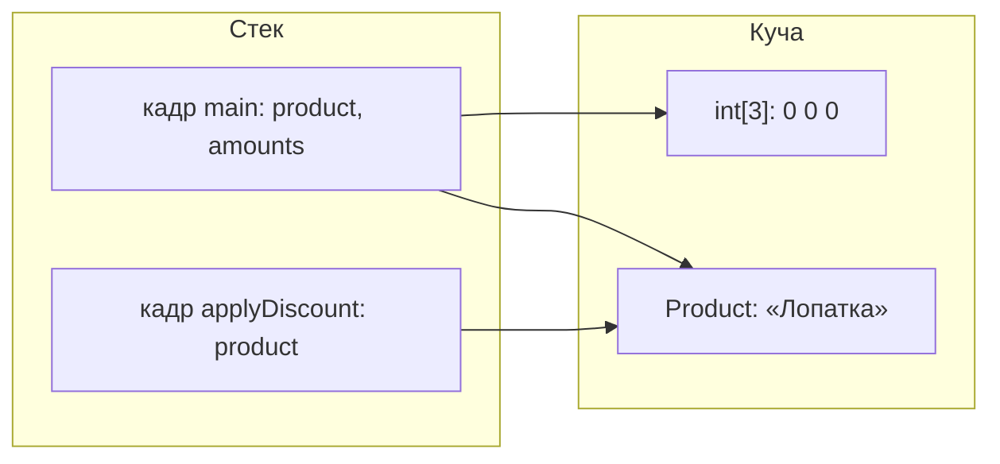

В кадре `main` находятся локальные переменные `amounts` и `product`.

Они хранят ссылки.

В куче находятся массив и объект `Product`.

В кадре `applyDiscount` появился собственный параметр `product`, который тоже содержит ссылку на тот же объект.

Эта схема подводит к важному вопросу: что именно Java передаёт в метод?

---

# 10. Передача объекта в метод

## 10.1. Java передаёт аргументы по значению

Рассмотрим:

```java
static void applyDiscount(Product product) {
    product.setPrice(product.getPrice() - 100);
}
```

Вызов:

```java
applyDiscount(product);
```

Поведение объекта иногда приводит к неточной фразе:

> Объекты в Java передаются по ссылке.

Точнее говорить иначе:

> В Java аргументы передаются по значению. Для объектной переменной этим значением является ссылка.

Что происходит при вызове:

```text
product в main
↓
хранит ссылку на объект

вызов applyDiscount(product)
↓
значение ссылки копируется

параметр product в applyDiscount
↓
хранит копию той же ссылки

обе ссылки
↓
ведут к одному объекту
```

---

## 10.2. Почему метод может изменить объект

Параметр `product` внутри `applyDiscount` — отдельная локальная переменная.

Но она указывает на тот же объект, что и переменная в `main`.

Поэтому:

```java
product.setPrice(...);
```

изменяет общий объект.

После завершения `applyDiscount` его кадр исчезнет вместе с локальным параметром. Но объект останется, потому что ссылка из `main` всё ещё существует.

---

## 10.3. Почему переприсваивание параметра не меняет внешнюю переменную

Рассмотрим другой метод:

```java
static void replace(Product product) {
    product = new Product("Новый товар");
}
```

И вызов:

```java
Product original = new Product("Лопатка");
replace(original);
```

До вызова:

```text
original
↓
объект "Лопатка"
```

При входе в `replace` значение ссылки копируется:

```text
original в main → объект "Лопатка"
product в replace → объект "Лопатка"
```

Затем выполняется:

```java
product = new Product("Новый товар");
```

Создаётся новый объект, а локальный параметр получает новую ссылку:

```text
original в main → объект "Лопатка"

product в replace → объект "Новый товар"
```

Внешняя переменная `original` не менялась.

После завершения метода его параметр исчезает вместе с кадром.

Если других ссылок на объект `"Новый товар"` нет, этот объект становится недостижимым после завершения метода.

Именно этот пример особенно хорошо показывает разницу между изменением объекта и изменением самой локальной ссылки.

---

# 11. `null`: ссылка без объекта

Ссылочная переменная может не указывать ни на какой объект.

Для этого используется значение:

```java
null
```

Например:

```java
Product product = null;
```

Это означает:

```text
переменная product существует
↓
ссылки на объект нет
```

Важно отличать две ситуации:

```text
Product product = new Product("Лопатка");
→ объект существует

Product product = null;
→ через эту переменную объекта нет
```

## 11.1. Почему возникает `NullPointerException`

Рассмотрим:

```java
Product product = null;
System.out.println(product.getPrice());
```

Чтобы выполнить `product.getPrice()`, JVM должна найти объект, у которого вызывается метод.

Но `product` равен `null`, поэтому объекта нет.

Возникает:

```text
NullPointerException
```

Современное сообщение JVM может выглядеть примерно так:

```text
NullPointerException: Cannot invoke "Product.getPrice()"
because "product" is null
```

Главная модель:

```text
product
↓
null

попытка вызвать метод
↓
объекта нет
↓
NullPointerException
```

## 11.2. Проверка на `null`

Если отсутствие объекта допустимо по логике программы, ссылку можно проверить:

```java
if (product != null) {
    System.out.println(product.getPrice());
}
```

Условие:

```java
product != null
```

означает:

```text
ссылка ведёт к объекту
→ можно работать с объектом
```

Это не означает, что перед каждым вызовом метода нужно механически ставить проверку `null`. Проверка нужна там, где отсутствие объекта действительно является допустимым состоянием программы.

## 11.3. Как отладчик помогает найти `NullPointerException`

В IDEA можно поставить breakpoint не только на строку кода, но и на исключение.

Если добавить Java Exception Breakpoint для `NullPointerException`, программа остановится в момент ошибки.

Тогда:

- `Frames` покажет цепочку вызовов;
- `Variables` покажет состояние текущего кадра;
- можно увидеть, какая именно ссылка равна `null`.

Так модель стека становится практическим инструментом отладки: ошибка привязана к конкретному кадру и конкретному состоянию локальных переменных.

---

# 12. `static`-поля и время жизни ссылок

До сих пор ссылки находились в локальных переменных методов.

Локальная переменная исчезает вместе с кадром.

Но ссылка может храниться и в поле класса.

Например:

```java
static Product cachedProduct;
```

Это не локальная переменная. Такое поле относится к классу и не исчезает после `return` конкретного метода.

Если выполнить:

```java
cachedProduct = new Product("Лопатка");
```

поле будет удерживать ссылку на объект.

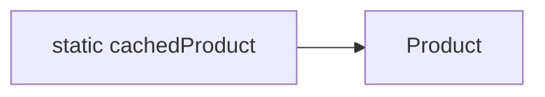

Метод, который создал объект, может завершиться, но объект останется достижимым через `static`-поле.

Именно поэтому `static`-поле особенно важно для темы памяти: оно может удерживать объект значительно дольше одного вызова метода.

Теперь возникает следующий вопрос:

> Кто решает, когда объект больше не нужен и его память можно освободить?

---

# 13. Сборщик мусора

Куча конечна.

Программа постоянно создаёт новые объекты:

```java
new Product("Лопатка");
new Product("Скребок");
new Product("Ведро");
```

Если бы память никогда не освобождалась, любой достаточно долго работающий процесс в конце концов исчерпал бы доступную память.

В Java освобождением памяти объектов занимается **сборщик мусора (`garbage collector`, GC)**.

Важно правильно понимать разделение ответственности.

Программист управляет:

- ссылками;
- тем, какие объекты остаются достижимыми;
- тем, не удерживает ли программа ненужные данные слишком долго.

JVM управляет:

- моментом запуска GC;
- самим процессом освобождения памяти недостижимых объектов.

То есть GC не освобождает «всё, что программист больше не планирует использовать». Он не знает намерений программиста. Он работает по более формальному правилу — **достижимости**.

---

# 14. Правило достижимости

Главная идея:

> Объект считается достижимым, пока к нему существует путь от корней по ссылкам.

В рамках нашего курса в качестве основных корней достаточно рассматривать:

- ссылки из активных кадров методов;
- `static`-поля доступных классов.

Рассмотрим:

```java
Product product = new Product("Скребок");
```

Пока метод выполняется и переменная `product` существует, есть путь:

```text
активный кадр
↓
product
↓
объект "Скребок"
```

Объект достижим.

Теперь:

```java
product = null;
```

Если других ссылок на объект нет, путь исчезает.

Объект становится недостижимым.

После этого GC **может** освободить его память.

Ключевое слово — «может».

```text
недостижим
≠
удалён немедленно
```

Точный момент освобождения памяти JVM не обещает.

---

# 15. Что происходит при переприсваивании ссылки

Рассмотрим:

```java
Product product = new Product("Скребок");

product = new Product("Ёмкость 10л");

product = null;
```

Предположим, других ссылок на эти объекты нет.

После первой строки:

```text
product
↓
"Скребок"
```

После второй создаётся новый объект, а переменная начинает ссылаться на него:

```text
product
↓
"Ёмкость 10л"
```

На `"Скребок"` больше нет ссылки.

Значит:

```text
"Скребок"
→ недостижим
```

После:

```java
product = null;
```

исчезает и последний путь к `"Ёмкости 10л"`.

Теперь оба объекта могут быть освобождены GC.

Важно: присваивание `null` не является командой «удалить объект». Оно лишь меняет ссылку. Недостижимость — следствие того, что путей к объекту больше не осталось.

---

# 16. Объекты могут удерживать другие объекты

Ссылка может находиться не только в локальной переменной.

Поле одного объекта может ссылаться на другой объект.

Поэтому достижимость распространяется по цепочке.

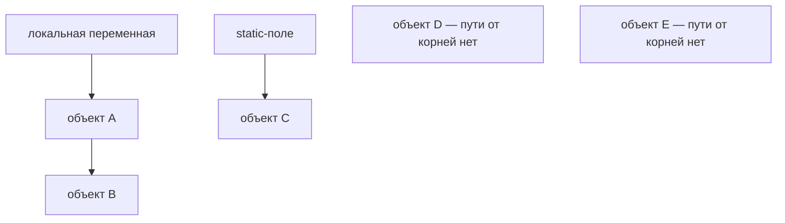

Здесь:

- объект A достижим через локальную переменную;
- объект B достижим через объект A;
- объект C достижим через `static`-поле;
- к D и E пути от корней нет.

Значит, D и E могут быть освобождены.

Главный принцип:

```text
важно не количество ссылок вообще
а наличие пути от корня
```

---

# 17. Островок мусора

Теперь рассмотрим два объекта, которые ссылаются друг на друга:

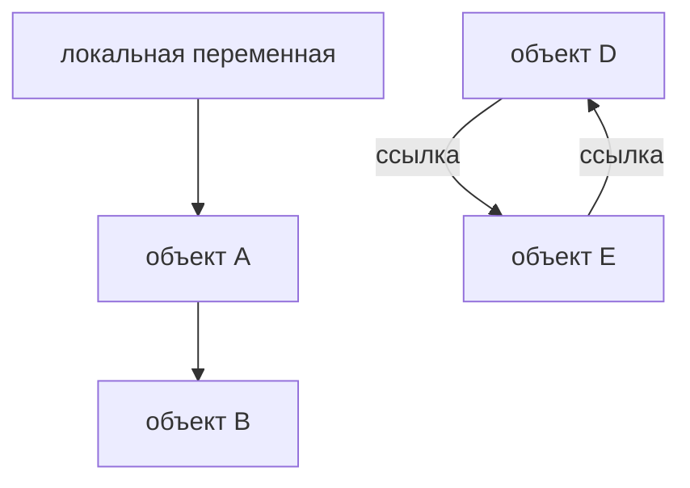

D и E взаимно удерживают ссылки.

Можно ошибочно решить:

> На D есть ссылка из E, а на E есть ссылка из D, значит, удалить их нельзя.

Но GC не просто считает ссылки.

Он проверяет достижимость от корней.

Если к D и E нельзя попасть из активного кадра, `static`-поля или другого достижимого объекта, весь этот «островок» недостижим.

```text
D ↔ E

но

от корней пути нет
↓
оба объекта — мусор
```

Это важная идея: взаимные ссылки сами по себе не мешают сборке мусора.

---

# 18. «Отметь и вымети»: учебная модель GC

Один из классических способов объяснить сборку мусора — **«отметь и вымети» (`mark and sweep`)**.

Идея состоит из двух шагов.

Сначала GC начинает от корней и идёт по ссылкам, отмечая всё достижимое.

Например:

```text
корень
↓
объект A
↓
объект B

static-поле
↓
объект C
```

A, B и C отмечены как живые.

Всё, что осталось неотмеченным, считается недостижимым.

Затем память таких объектов можно освободить.

Коротко:

```text
mark
→ отметить живое

sweep
→ освободить остальное
```

Это не попытка описать во всех деталях любой современный Java GC. Это учебная модель, которая хорошо объясняет главное правило: сборщик сначала определяет, что достижимо, а всё остальное может считать мусором.

---

# 19. Когда запускается GC

Было бы слишком дорого после каждого `new` полностью проверять кучу.

Поэтому GC запускается не после каждого созданного объекта, а по собственному расписанию JVM и в зависимости от состояния памяти.

Отсюда следуют два важных практических вывода.

Первый:

```java
System.gc();
```

нельзя воспринимать как безусловную команду «собери мусор немедленно».

Это просьба JVM, а не гарантия немедленной сборки.

Второй вывод:

> Нельзя строить логику программы на ожидании, что конкретный объект будет освобождён в конкретный момент времени.

Программа должна быть корректной независимо от того, когда именно JVM выполнит очередную сборку.

---

# 20. Куча изнутри: поколения

Эта часть темы обзорная.

Наша цель — не изучить настройку GC, а понять, что обычно имеется в виду под поколениями объектов.

Практическое наблюдение:

> Большинство объектов живёт недолго.

Метод может создать временный объект, выполнить работу и закончиться. Если других ссылок нет, объект быстро становится недостижимым.

Поэтому удобно собирать молодые объекты отдельно от долгоживущих.

Упрощённая схема:


Новые объекты обычно начинают жизнь в области молодых объектов — в учебной модели это `Eden`.

Если объект пережил сборку, он может оказаться в областях выживших — `S0` или `S1`.

Если объект живёт долго, он может перейти в `Old`.

Главная идея поколений:

```text
молодых объектов много
↓
большинство быстро умирает
↓
их удобно собирать отдельно

долгоживущие объекты
↓
меняются реже
↓
старую область можно собирать реже
```

Подробные алгоритмы перемещения, размеры областей и настройки JVM находятся за рамками этого семинара.

---

# 21. Почему `static` может удерживать объект слишком долго

Вернёмся к:

```java
static Product cachedProduct;
```

Если `static`-поле долго хранит ссылку, объект остаётся достижимым.

Это может быть совершенно нормальным: например, объект действительно нужен всё время работы приложения.

Но возможна и другая ситуация: с точки зрения бизнес-логики объект уже не нужен, а ссылка всё ещё осталась.

Тогда происходит следующее:

```text
программе объект уже не нужен
↓
но путь от корня всё ещё существует
↓
GC считает объект живым
↓
освободить память нельзя
```

Так в Java возможны утечки памяти даже при наличии GC.

Сборщик мусора умеет освобождать недостижимые объекты. Он не умеет угадывать, что достижимый объект «по смыслу уже не нужен».

---

# 22. Как исчерпать память кучи

Стек переполняется большим количеством одновременно активных вызовов.

Куча заканчивается по другой причине: JVM не может выделить достаточно места под новые объекты.

Но есть важная деталь. Если старые объекты становятся недостижимыми, GC может освобождать их память.

Поэтому для демонстрации `OutOfMemoryError` нужно создать ситуацию, в которой программа требует всё больше памяти.

В плане семинара рассматриваются два простых примера.

## 22.1. Растущая строка

```java
String s = "a";

while (true) {
    s = s + s;
}
```

Строки в Java неизменяемы.

Операция:

```java
s + s
```

не расширяет старый объект. Она создаёт новый результат.

Размер строки растёт:

```text
"a"
↓
"aa"
↓
"aaaa"
↓
"aaaaaaaa"
↓
...
```

Каждый новый объект примерно вдвое больше предыдущего.

Даже если старые строки становятся мусором, очередная строка очень быстро требует огромного объёма памяти.

В какой-то момент JVM не сможет выделить место.

## 22.2. Огромный массив

Другой вариант:

```java
int[] huge = new int[Integer.MAX_VALUE];
```

Программа сразу просит чрезвычайно большой массив.

Если JVM не может выделить необходимый объём памяти, создание массива завершается ошибкой.

---

# 23. `OutOfMemoryError`

Один из вариантов сообщения:

```text
OutOfMemoryError: Java heap space
```

Часть `Java heap space` уточняет, что проблема связана именно с кучей.

Не нужно путать эту ошибку со `StackOverflowError`.

```text
StackOverflowError
→ слишком глубокая цепочка активных вызовов
→ проблема стека

OutOfMemoryError: Java heap space
→ JVM не может выделить достаточно памяти объектам
→ проблема кучи
```

У `OutOfMemoryError` бывают и другие причины, поэтому полезно смотреть полное сообщение. Но на этом семинаре основной сценарий — нехватка памяти в heap.

---

# 24. Три ошибки: `NullPointerException`, `StackOverflowError`, `OutOfMemoryError`

Теперь можно сопоставить три ситуации.

| Ошибка | Что означает | Типичная причина в наших примерах |
|---|---|---|
| `NullPointerException` | обращение к объекту через `null` | ссылка не указывает на объект |
| `StackOverflowError` | превышен доступный стек вызовов | рекурсия без остановки |
| `OutOfMemoryError: Java heap space` | JVM не может выделить память в куче | слишком большой или долго удерживаемый объём объектов |

Важно: `NullPointerException` вообще не означает, что память закончилась.

Это ошибка обращения:

```text
ссылка = null
↓
объекта нет
↓
пытаемся использовать объект
```

`StackOverflowError` означает:

```text
слишком много одновременно активных кадров
```

`OutOfMemoryError: Java heap space` означает:

```text
не хватает памяти для размещения объекта в куче
```

---

# 25. Строки и ссылки

Строки уже знакомы по предыдущей неделе:

```java
String text = "java";
```

Теперь можно объяснить их поведение через ссылочную модель.

`String` — объектный тип.

Значит, переменная `String` хранит ссылку на объект строки.

Но у строк есть дополнительная особенность. Строковые литералы очень часто повторяются в программе:

```java
"Да"
"Нет"
"java"
```

Было бы расточительно без необходимости создавать отдельный одинаковый объект для каждого повторения литерала.

Поэтому JVM использует **пул строк (`string pool`)**.

---

# 26. Пул строк

Рассмотрим:

```java
String first = "java";
String second = "java";
```

Одинаковый литерал можно переиспользовать.

Упрощённая схема:

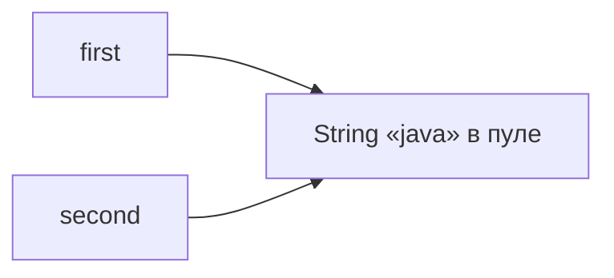

Обе переменные могут указывать на один объект.

Поэтому:

```java
System.out.println(first == second);
```

в таком примере даст:

```text
true
```

Но отсюда нельзя делать вывод, что строки нужно сравнивать через `==`.

Чтобы понять почему, нужно вспомнить, что именно сравнивает `==` у объектных ссылок.

---

# 27. Что проверяет `==` у объектов

Для объектных переменных выражение:

```java
first == second
```

задаёт вопрос:

> Содержат ли переменные ссылки на один и тот же объект?

То есть `==` не просматривает поля и не сравнивает текст посимвольно.

Для двух одинаковых строковых литералов получилось `true`, потому что пул позволил переиспользовать один объект.

В данном конкретном случае совпали два факта:

```text
содержимое одинаковое
+
объект один и тот же
```

Но эти факты не обязаны совпадать всегда.

---

# 28. Одинаковый текст, разные объекты

Рассмотрим:

```java
String first = "java";
String part = "jav";
String third = part + "a";

System.out.println(first == third);
```

По содержимому:

```text
first → "java"
third → "java"
```

Но `third` создаётся во время выполнения как результат конкатенации.

Упрощённая модель:

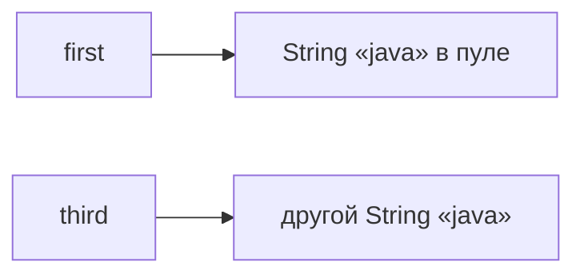

Поэтому сравнение ссылок:

```java
first == third
```

даёт:

```text
false
```

Текст одинаковый, но ссылки ведут к разным объектам.

---

# 29. `equals()` для строк

Если задача — сравнить содержимое строк, нужно использовать:

```java
equals()
```

Например:

```java
System.out.println(first.equals(third));
```

Результат:

```text
true
```

Сравнение можно свести к таблице:

| Операция | Что проверяет для `String` |
|---|---|
| `==` | один ли это объект |
| `equals()` | одинаково ли содержимое строк |

Раньше правило «строки сравниваем через `equals()`» можно было просто запомнить.

Теперь понятна причина: `String` — объект, а `==` у ссылок проверяет идентичность объекта, а не смысловое равенство содержимого.

---

# 30. Неизменяемость строк и пул

Строки в Java **неизменяемы (`immutable`)**.

Это означает: существующий объект `String` нельзя изменить.

Например:

```java
String text = "java";
text.toUpperCase();
```

не превращает объект `"java"` в `"JAVA"`.

Метод возвращает новый результат, который нужно сохранить:

```java
text = text.toUpperCase();
```

Почему неизменяемость важна для пула?

Представим, что две переменные используют один объект:

```text
first ─┐
       ├──→ "java"
second ┘
```

Если бы строку можно было изменить через `first`, неожиданно изменилось бы и значение, наблюдаемое через `second`.

Но объект `String` изменить нельзя.

Поэтому одну строку из пула безопасно разделять между множеством ссылок.

Именно неизменяемость делает такую модель удобной.

---

# 31. Конкатенация создаёт новый результат

Из неизменяемости следует важное поведение.

Рассмотрим:

```java
String text = "a";
text = text + "b";
```

Не происходит:

```text
объект "a"
↓
изменился в "ab"
```

Происходит создание нового результата:

```text
старый объект "a"

новый объект "ab"
```

Переменная `text` начинает ссылаться на новый объект.

Поэтому пример из раздела про `OutOfMemoryError`:

```java
String s = "a";

while (true) {
    s = s + s;
}
```

связан сразу с двумя идеями:

```text
String неизменяем
↓
операция создаёт новый результат
↓
в куче появляются новые объекты
↓
размер результата быстро растёт
↓
в конце можно исчерпать доступную память
```

---

# 32. `intern()`

Метод `intern()` позволяет получить ссылку на строку из пула.

Пример:

```java
String first = "java";
String part = "jav";
String third = (part + "a").intern();

System.out.println(first == third);
```

В этом случае `intern()` ищет подходящую строку в пуле и возвращает ссылку, связанную с пулом.

Результат в таком примере:

```text
true
```

Но важно правильно понять цель примера.

`intern()` не нужен для обычного сравнения строк.

Правило остаётся прежним:

```text
сравниваем текст
→ equals()
```

`intern()` рассматривается здесь обзорно, чтобы показать, что пул строк — реальный механизм переиспользования строковых объектов.

---

# 33. Возвращаемся к вопросам из начала

Теперь можно ответить на вопросы, с которых начиналась тема.

Первый вопрос:

> Метод закончил работу. Его локальные переменные исчезли. Почему объект иногда остаётся?

Потому что локальные переменные относятся к кадру метода, а объект находится в куче.

Если после `return` остаётся другая ссылка на объект, он по-прежнему достижим.

Например:

```java
static Product createDefault() {
    return new Product("Лопатка");
}
```

`createDefault` создаёт объект и возвращает ссылку.

После:

```java
Product product = createDefault();
```

кадр `createDefault` уже уничтожен, но в `main` есть ссылка `product`.

Поэтому объект остаётся достижимым.

Второй вопрос:

> Почему изменение через одну переменную видно через другую?

Потому что:

```java
Product second = first;
```

копирует ссылку, а не объект.

Получаются две переменные, которые ведут к одному объекту.

Третий вопрос:

> Почему объект не удаляется сразу после потери ссылки?

Потому что потеря последнего пути делает объект недостижимым, но момент фактической сборки выбирает JVM.

Четвёртый вопрос:

> Почему `static`-поле может удерживать память?

Потому что пока существует путь от корня через `static`-поле к объекту, объект считается достижимым и GC не имеет права его освободить.

---

# 34. Полная трассировка одного примера

Соберём стек, кучу, ссылки и `return` в одной программе.

Класс:

```java
class Product {

    private String name;
    private int price;

    Product(String name) {
        this.name = name;
    }

    public void setPrice(int price) {
        this.price = price;
    }

    public int getPrice() {
        return price;
    }
}
```

Программа:

```java
public class Main {

    public static void main(String[] args) {
        Product product = createProduct();
        applyDiscount(product);

        System.out.println(product.getPrice());
    }

    static Product createProduct() {
        Product product = new Product("Лопатка");
        product.setPrice(500);
        return product;
    }

    static void applyDiscount(Product product) {
        product.setPrice(product.getPrice() - 100);
    }
}
```

Разберём выполнение.

## Шаг 1. Запускается `main`

Создаётся кадр `main`.

```text
Stack:
main
```

Переменная `product` ещё не получила результат.

## Шаг 2. `main` вызывает `createProduct`

Появляется новый кадр:

```text
Stack:
createProduct
main
```

## Шаг 3. Выполняется `new Product(...)`

В куче создаётся объект.

Локальная переменная `product` внутри `createProduct` получает ссылку.

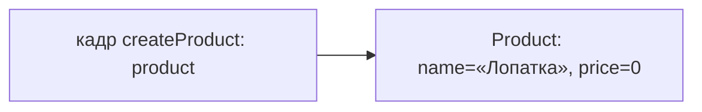

## Шаг 4. Меняется поле объекта

После:

```java
product.setPrice(500);
```

состояние объекта:

```text
name = "Лопатка"
price = 500
```

## Шаг 5. `return product`

Возвращается значение переменной `product`.

Это значение — ссылка.

Ссылка передаётся в `main`.

Кадр `createProduct` уничтожается.

Теперь:

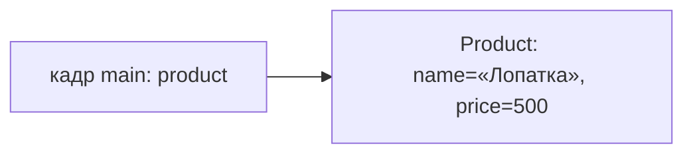

Объект пережил создавший его вызов, потому что остался достижимым из `main`.

## Шаг 6. Вызывается `applyDiscount`

Появляется новый кадр.

Значение ссылки копируется в параметр:

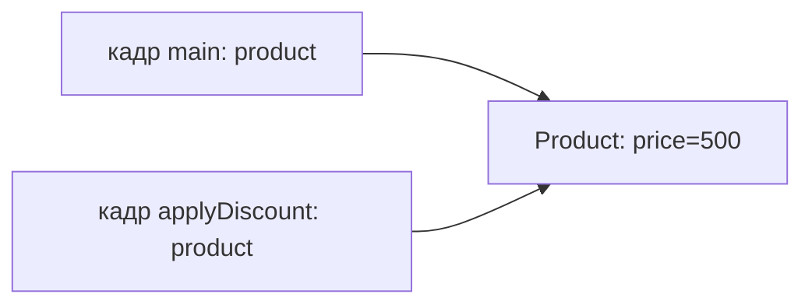

Переменных две, объект один.

## Шаг 7. Изменяется общий объект

Внутри метода:

```java
product.setPrice(product.getPrice() - 100);
```

поле `price` становится равным `400`.

## Шаг 8. `applyDiscount` завершается

Кадр метода уничтожается.

Его локальный параметр `product` исчезает.

Но ссылка из `main` остаётся:

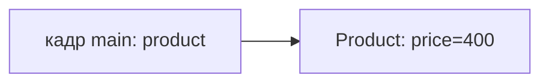

## Шаг 9. `println`

`main` обращается к тому же объекту:

```java
System.out.println(product.getPrice());
```

Получаем:

```text
400
```

Этот пример связывает почти всю тему: кадры, `return`, кучу, ссылки, передачу по значению и время жизни объекта.

---

# Типичные ошибки

## Ошибка 1. Считать, что объект «лежит внутри переменной»

Грубая модель:

```text
product содержит объект
```

теперь становится недостаточной.

Точнее:

```text
product
→ хранит ссылку

объект
→ находится отдельно в куче
```

Именно это объясняет `null`, копирование ссылок и передачу объектов в методы.

## Ошибка 2. Считать, что присваивание копирует объект

Код:

```java
Product second = first;
```

не создаёт второй объект.

Новый объект появляется при `new`.

Здесь копируется значение ссылки.

## Ошибка 3. Говорить «Java передаёт объект по ссылке»

Точнее:

```text
int
→ копируется значение числа

Product
→ копируется значение ссылки
```

И в обоих случаях Java использует передачу аргумента по значению.

## Ошибка 4. Считать, что `product = null` немедленно удаляет объект

Код:

```java
product = null;
```

меняет значение переменной.

Если это была последняя ссылка, объект становится недостижимым.

Но точный момент освобождения памяти выбирает GC.

## Ошибка 5. Считать взаимные ссылки защитой от GC

Если два объекта ссылаются друг на друга, но путь от корней отсутствует, оба объекта недостижимы и могут быть собраны.

## Ошибка 6. Сравнивать содержимое строк через `==`

У строк:

```text
==
→ сравнение ссылок

equals()
→ сравнение содержимого
```

Пул строк может сделать некоторые ошибочные примеры «работающими», но это не меняет правила.

## Ошибка 7. Путать `StackOverflowError` и `OutOfMemoryError`

```text
StackOverflowError
→ слишком много активных кадров

OutOfMemoryError: Java heap space
→ JVM не хватает места в куче
```

Это разные области памяти и разные причины.

---

# Что пока не изучаем подробно

Устройство памяти JVM — большая отдельная тема. На этом семинаре используется намеренно упрощённая модель.

Пока не разбираем подробно:

- конкретные реализации GC;
- G1, ZGC, Shenandoah и другие сборщики;
- точные размеры и настройку поколений;
- JVM-флаги управления памятью;
- внутреннее представление ссылок;
- объектные заголовки;
- выравнивание объектов;
- JIT-компиляцию;
- escape analysis;
- heap dump и инструменты production-диагностики;
- устройство Metaspace.

Про Metaspace достаточно знать, что это отдельная область, связанная с метаданными классов. Детальное устройство здесь не требуется.

Про поколения достаточно модели:

```text
новые объекты
→ Eden

пережившие сборки
→ Survivor

долгожители
→ Old
```

Главная цель — понимать смысл, а не запоминать внутренние настройки JVM.

---

# Итог недели

Соберём тему в одну модель.

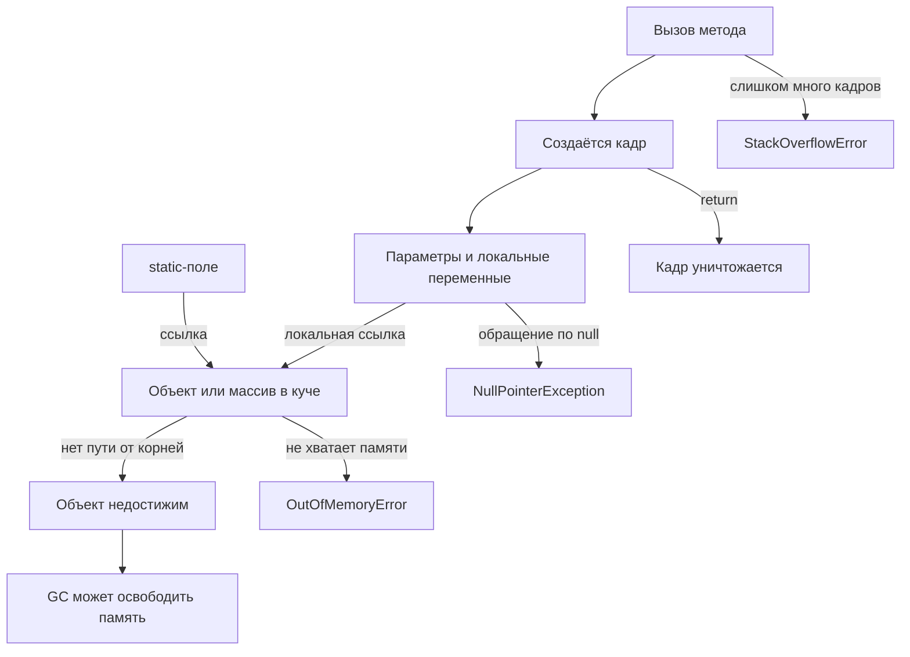

Теперь эту схему можно прочитать последовательно.

Метод вызывается — появляется кадр.

Кадр хранит параметры и локальные переменные.

Локальная объектная переменная хранит ссылку.

Объект или массив находится в куче.

После `return` кадр исчезает.

Объект не обязан исчезать вместе с кадром, если на него осталась другая ссылка.

Пока от корней есть путь к объекту, объект достижим.

Когда пути исчезают, объект становится недостижимым и GC получает возможность освободить его память.

---

# Что нужно понимать после недели

После этого материала важно уметь объяснить не только определения, но и поведение кода.

Нужно понимать следующее.

**Стек вызовов (`call stack`)** хранит активные вызовы методов.

Каждый вызов создаёт отдельный **кадр (`stack frame`)**.

Кадр содержит параметры и локальные переменные конкретного вызова.

После завершения вызова кадр уничтожается.

В учебной модели локальный примитив хранит своё значение.

Переменная объектного типа хранит ссылку.

Объекты и массивы находятся в куче.

Присваивание объектной переменной копирует ссылку, а не объект.

Поэтому две переменные могут вести к одному объекту.

Java передаёт аргументы по значению. Для объектной переменной копируется значение ссылки.

Изменение общего объекта через параметр видно вызывающему коду.

Переприсваивание параметра не переприсваивает переменную вызывающего метода.

`null` означает отсутствие ссылки на объект.

Обращение к объекту через `null` приводит к `NullPointerException`.

GC освобождает память объектов, которые стали недостижимыми.

Недостижимость не означает немедленного освобождения памяти.

`static`-поле может долго удерживать объект достижимым.

Взаимные ссылки не спасают недостижимый островок объектов от GC.

Поколения — способ эффективнее работать с тем фактом, что большинство объектов живёт недолго.

`StackOverflowError` связан с глубиной стека вызовов.

`OutOfMemoryError: Java heap space` связан с нехваткой памяти в куче.

Строки — объекты.

Одинаковые строковые литералы могут использовать один объект из пула.

`==` сравнивает ссылки.

`equals()` сравнивает содержимое строк.

Неизменяемость строк делает совместное использование строковых объектов безопасным.

---

# Практическая самопроверка

Попробуем объяснить несколько фрагментов без запуска программы.

## Задача 1

```java
Product first = new Product("Лопатка");
Product second = first;
```

Сколько объектов `Product` создано?

Нужно увидеть:

```text
один new
→ один новый объект
```

Переменных две, объект один.

## Задача 2

```java
Product first = new Product("Лопатка");
Product second = first;

second.setPrice(500);

System.out.println(first.getPrice());
```

Почему `first` видит цену `500`?

Правильное объяснение: обе ссылки ведут к одному объекту.

## Задача 3

```java
static void replace(Product product) {
    product = new Product("Скребок");
}
```

Почему `replace(original)` не меняет ссылку в `original`?

Потому что параметр получает копию значения ссылки и переприсваивается только локальная переменная метода.

## Задача 4

```java
Product product = null;
product.getPrice();
```

Почему это не `OutOfMemoryError`?

Потому что память не закончилась. Программа пытается вызвать метод через ссылку, которая не указывает на объект.

## Задача 5

```java
static void repeat() {
    repeat();
}
```

Почему возникает `StackOverflowError`?

Каждый вызов ждёт следующий и остаётся активным, поэтому новые кадры наслаиваются до предела стека.

## Задача 6

```java
String first = "java";
String second = "java";

System.out.println(first == second);
```

Почему результат может быть `true`?

Потому что одинаковые литералы могут ссылаться на один объект из пула.

Но сравнивать содержание строк всё равно нужно через `equals()`.

## Задача 7

```java
String first = "java";
String part = "jav";
String second = part + "a";

System.out.println(first.equals(second));
```

Почему результат `true`, даже если ссылки могут вести к разным объектам?

Потому что `equals()` для строк сравнивает содержимое.

---

# Переход к следующим темам

Модель памяти не останется отдельным теоретическим блоком.

Она будет использоваться дальше по всему курсу.

При изучении исключений `NullPointerException` уже не будет выглядеть загадочной: мы знаем, что это обращение через `null`.

При работе с коллекциями важно помнить, что коллекции работают с объектами и ссылками на них.

При отладке `Frames` и `Variables` будут напрямую показывать стек и состояние кадров.

При работе со строками ссылочная модель объясняет разницу между `==` и `equals()`.

Короткая модель, которую стоит унести с семинара:

```text
вызов метода
→ новый кадр

кадр
→ параметры и локальные переменные

локальная переменная объектного типа
→ ссылка

объект / массив
→ куча

return
→ кадр исчезает

нет пути от корней к объекту
→ объект недостижим
→ GC может освободить память
```

Именно эта модель связывает методы, объекты, ссылки и автоматическое управление памятью в Java.
