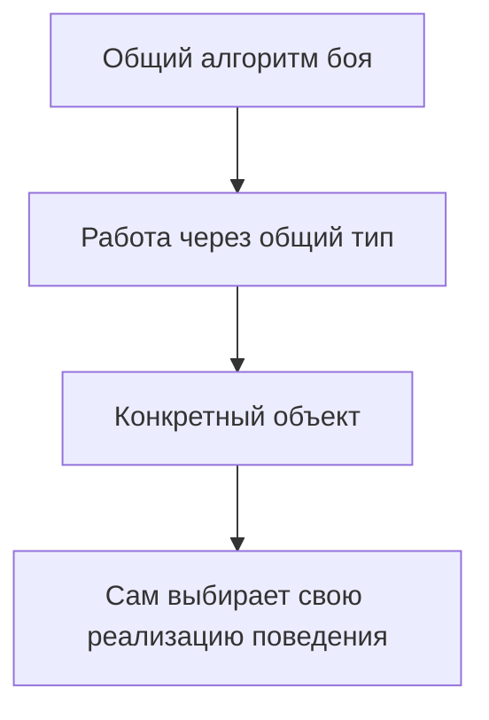
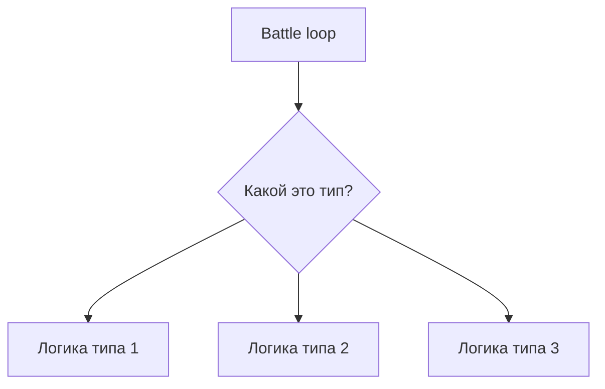
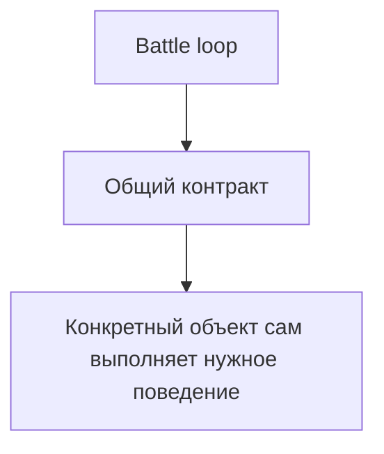

# Java 1. Неделя 5 — Advanced Track

# Тактическая арена: пошаговый бой

**Уровень:** Advanced  
**Ориентировочное время:** 90–120 минут

Эта задача предназначена для студентов, которые уверенно работают с классами, объектами и массивами и хотят собрать один небольшой проект вокруг темы недели 5.


Главная цель — не выполнить формальный список классов и методов, а **самостоятельно спроектировать модель**.

Не будет задано:

- сколько именно классов должно быть;
- как они должны называться;
- какие поля должны находиться в каждом классе;
- какие методы должны быть `public` или `private`;
- где именно должна находиться каждая часть логики.

Все эти решения лежат на вас.

---

# Что должно получиться

Нужно реализовать небольшую программу, моделирующую **пошаговый бой двух команд**.

В каждой команде находятся разные типы бойцов.

Например, в игре могут быть:

```text
воин
маг
лучник
```

У них есть общие свойства:

- имя или позывной;
- запас здоровья;
- возможность атаковать;
- возможность получать урон;
- состояние «жив / побеждён».

При этом конкретные типы бойцов ведут себя по-разному.

Например:

- один лучше защищается;
- другой использует ману;
- третий расходует стрелы;
- у некоторых есть дополнительное восстановление между раундами.

Программа должна позволять обрабатывать всех бойцов через **общий тип**, но при этом каждый конкретный объект должен выполнять собственную реализацию поведения.

---

# Главная архитектурная идея

Общий алгоритм боя не должен знать подробности каждого конкретного типа.

Плохо:

```text
если это Warrior
    считать урон так

если это Mage
    считать урон иначе

если это Archer
    ещё одна формула
```

Нужна модель:



То есть общий код должен уметь сказать примерно:

```text
атакуй цель
```

не спрашивая заранее:

```text
кто ты конкретно?
```

---

## Не используйте рандомные числа для рассчета атаки и пр параметров, чтобы результат боя можно было воспроизводить и проверять

---

# Общие требования к модели

В модели должно существовать понятие:

```text
боевой юнит
```

но создавать «просто боевой юнит» без конкретного типа не должно иметь смысла.

Разные виды бойцов должны иметь общую часть и специализированную часть.

Например, все они:

- имеют здоровье;
- могут быть живыми или побеждёнными;
- умеют атаковать;
- умеют получать урон.

Но конкретный тип может дополнительно иметь:

- броню;
- ману;
- боеприпасы;
- особое правило усиления;
- собственную механику восстановления.

Самостоятельно реши:

- что должно находиться в общей части;
- что принадлежит только конкретному типу;
- где нужен абстрактный метод;
- где можно дать общую реализацию;
- где стоит переопределить поведение.

---

# Правила боя

Бой проходит по раундам.

В каждом раунде:

1. первая команда атакует вторую;
2. затем вторая команда атакует первую;
3. после завершения атак часть бойцов может восстановить свой специальный ресурс;
4. если в одной из команд не осталось живых бойцов, бой заканчивается.

Внутри команды бойцы ходят в фиксированном порядке.

Например:

```text
позиция 0
позиция 1
позиция 2
```

Побеждённый боец:

- не атакует;
- не восстанавливает ресурс;
- остаётся частью истории боя, но больше не участвует в активных действиях.

---

# Выбор цели

Для основной версии используется простое правило:

> каждый атакующий выбирает первого живого противника в порядке команды.

Например:

```text
Opponent 1 — defeated
Opponent 2 — alive
Opponent 3 — alive
```

целью становится:

```text
Opponent 2
```

Если он побеждён, следующий атакующий должен выбрать уже следующего живого противника.

---

# Разные типы поведения

Нужно реализовать минимум **три существенно различающихся типа бойцов**.

Они должны отличаться не только названием.

Например можно использовать следующую модель.

---

## Боец ближнего боя

Особенности:

- имеет дополнительную защиту;
- уменьшает входящий урон;
- при низком здоровье атакует сильнее.

Пример правила:

```text
обычный урон:
baseDamage

если текущее здоровье <= половины максимального:
baseDamage + 5
```

При получении урона защита уменьшает его.

При этом успешная атака должна наносить минимум:

```text
1
```

урона.

Эта часть должна естественно потребовать переопределения поведения получения урона.

Желательно использовать реализацию базового класса через:

```java
super
```

а не полностью копировать общую логику.

---

## Магический боец

Особенности:

- имеет ограниченный запас маны;
- сильная атака расходует ману;
- при недостатке маны использует более слабую атаку;
- после раунда частично восстанавливает ману.

Пример:

```text
если mana >= 30:
    damage = baseDamage + 20
    mana -= 30

иначе:
    damage = baseDamage
```

После раунда:

```text
mana += 10
```

но не выше максимума.

---

## Дальний боец

Особенности:

- имеет ограниченный запас боеприпасов;
- усиленная атака расходует несколько единиц ресурса;
- при недостатке боеприпасов использует слабую атаку;
- после раунда частично восстанавливает боеприпасы.

Пример:

```text
если arrows >= 2:
    damage = baseDamage + 10
    arrows -= 2

иначе:
    damage = baseDamage / 2
```

После раунда:

```text
arrows += 1
```

но не выше максимального значения.

---

# Дополнительная способность через интерфейс

Не все бойцы должны уметь восстанавливать специальный ресурс.

Например:

```text
маг
лучник
```

умеют,

а:

```text
воин
```

не умеет.

Эту способность нужно выразить через **отдельный интерфейс**.

После завершения раунда общий алгоритм должен определить:

```text
поддерживает ли объект способность восстановления?
```

и только в этом случае вызвать соответствующее действие.

Здесь применение:

```java
instanceof
```

считается оправданным.

---

# Когда `instanceof` считается ошибкой

`instanceof` нельзя использовать для выбора основной боевой логики.

Например нельзя писать:

```java
if (unit instanceof Warrior) {
    ...
} else if (unit instanceof Mage) {
    ...
} else if (unit instanceof Archer) {
    ...
}
```

чтобы:

- считать урон;
- выбирать формулу атаки;
- определять защиту;
- расходовать ману;
- расходовать стрелы.

Если операция существует у всех бойцов, но выполняется по-разному, различие должно выражаться через полиморфизм.

---

# Команды

В системе должны существовать две команды.

Каждая команда:

- имеет название;
- хранит фиксированное количество бойцов;
- может содержать разные конкретные типы;
- умеет находить первого живого бойца;
- умеет определить, остались ли живые бойцы.

Коллекции использовать нельзя.

То есть внутри естественно появится массив общего типа.

Самостоятельно реши:

- кто отвечает за добавление бойцов;
- как контролируется заполненность;
- как запрещаются некорректные дубликаты;
- стоит ли отдавать внутренний массив наружу;
- какие вспомогательные операции нужны команде.

---

# Наследование или композиция

Важно не пытаться представить всё через наследование.

Команда:

```text
не является бойцом
```

Она:

```text
содержит бойцов
```

Арена:

```text
не является командой
```

Она:

```text
работает с двумя командами
```

В модели должны естественно сочетаться:

```text
наследование
+
интерфейсы
+
композиция
```

---

# Равенство бойцов

У каждого бойца есть уникальный:

```text
callSign
```

или аналогичный идентификатор.

Два объекта должны считаться одинаковыми по смыслу, если их идентификаторы совпадают.

Например:

```text
тип 1: Warrior
callSign = Atlas
```

и:

```text
тип 2: Mage
callSign = Atlas
```

должны считаться одним и тем же бойцом по смыслу системы.

Для этого нужно корректно определить:

```java
equals()
hashCode()
```

Важно:

- `==` и `equals()` должны демонстрировать разные вещи;
- изменяемые параметры вроде текущего здоровья не должны участвовать в смысловой идентичности;
- если два объекта равны через `equals()`, их `hashCode()` должен совпадать.

---

# Текстовое представление

Для объектов бойцов нужно сделать полезный:

```java
toString()
```

Из результата должно быть понятно минимум:

- какой это тип;
- какой у него идентификатор;
- сколько осталось здоровья;
- какое состояние специфического ресурса у конкретного типа.

Например:

```text
Warrior{Atlas, health=52/120, armor=5}
```

```text
Mage{Nova, health=80/80, mana=40/100}
```

Формат можно выбрать самостоятельно.

---

# Начальный сценарий

Используй две команды по три бойца.

## Команда North

```text
Warrior
callSign = Atlas
maxHealth = 120
baseDamage = 18
armor = 5
```

```text
Mage
callSign = Nova
maxHealth = 80
baseDamage = 12
mana = 60
maxMana = 100
```

```text
Archer
callSign = Hawk
maxHealth = 90
baseDamage = 14
arrows = 6
maxArrows = 6
```

## Команда South

```text
Warrior
callSign = Titan
maxHealth = 110
baseDamage = 20
armor = 4
```

```text
Mage
callSign = Echo
maxHealth = 75
baseDamage = 13
mana = 60
maxMana = 100
```

```text
Archer
callSign = Lynx
maxHealth = 85
baseDamage = 15
arrows = 6
maxArrows = 6
```

Порядок бойцов внутри команды должен совпадать с порядком выше.

---

# Проверка первого раунда

Первый раунд должен быть полностью воспроизводим.

В начале:

```text
North:
Atlas 120
Nova   80
Hawk   90

South:
Titan 110
Echo   75
Lynx   85
```

После атак North:

```text
Titan health = 48
Nova mana = 30
Hawk arrows = 4
```

После ответных атак South:

```text
Atlas health = 52
Echo mana = 30
Lynx arrows = 4
```

После восстановления ресурсов:

```text
Nova mana = 40
Hawk arrows = 5

Echo mana = 40
Lynx arrows = 5
```

Итог после первого раунда:

```text
North

Atlas
health = 52

Nova
health = 80
mana = 40

Hawk
health = 90
arrows = 5
```

```text
South

Titan
health = 48

Echo
health = 75
mana = 40

Lynx
health = 85
arrows = 5
```

Если состояние отличается, сначала нужно исправить механику одного раунда.

---

# Проверка второго раунда

После второго раунда ожидается:

```text
North

Atlas
health = 4

Nova
health = 80
mana = 20

Hawk
health = 90
arrows = 4
```

```text
South

Titan
health = 0

Echo
health = 75
mana = 20

Lynx
health = 85
arrows = 4
```

Важный момент:

> Titan был побеждён в первой половине второго раунда и поэтому не должен атаковать в ответной фазе.

---

# Полный бой

После проверки первых раундов запусти бой автоматически.

Чтобы исключить бесконечную игру, можно задать максимальное количество раундов:

```text
20
```

Для приведённых исходных данных ожидается:

```text
Winner: North
Rounds: 7
```

Точный формат вывода можно выбрать самостоятельно.

---

# Инварианты

После любой публичной операции модель должна оставаться корректной.

Не должно возникать состояний:

```text
health < 0
```

```text
health > maxHealth
```

```text
mana < 0
```

```text
mana > maxMana
```

```text
arrows < 0
```

```text
arrows > maxArrows
```

Также не должно происходить:

```text
побеждённый боец атакует
```

```text
побеждённый боец восстанавливает ресурс
```

```text
два разных объекта с одинаковым callSign добавлены в одну команду
```

---

# Проверка `equals()` и `hashCode()`

После основной реализации создай второй объект с тем же:

```text
callSign = Atlas
```

но:

- другого конкретного типа;
- с другими характеристиками.

Проверь:

```text
original == duplicate
```

и:

```text
original.equals(duplicate)
```

Результаты должны отличаться.

Также проверь:

```text
original.hashCode() == duplicate.hashCode()
```

если `equals()` возвращает `true`.

Попытка добавить такой объект в ту же команду должна быть отклонена.

---

# Проверка полиморфизма

Создай отдельный массив общего типа и положи в него несколько разных бойцов.

Одним циклом:

- выведи каждый объект;
- вызови общее боевое поведение;
- не проверяй конкретный класс перед обычной атакой.

Главный вопрос:

> Почему переменная общего типа вызывает разные реализации метода у разных объектов?

---

# Проверка `instanceof`

Отдельно обработай объекты, которые поддерживают восстановление специального ресурса.

Здесь допустима проверка:

```text
реализует ли объект нужную способность?
```

Но не:

```text
является ли объект конкретным классом?
```

для выбора обычного боевого поведения.

---

# Проверка расширяемости

После завершения основной версии добавь четвёртый тип бойца:

```text
Berserker
```

Пример правил:

```text
обычная атака:
baseDamage
```

если здоровье не больше:

```text
maxHealth / 3
```

атака:

```text
baseDamage * 2
```

Получение урона обычное.

Главное требование:

> После добавления нового типа не должно потребоваться менять общий алгоритм боя.

Если для поддержки нового типа приходится добавлять новую ветку:

```text
if Berserker ...
```

в общем боевом цикле — модель спроектирована неудачно.

---

# Что нужно решить самостоятельно

В отличие от базового задачника, здесь специально не задаётся готовая структура программы.

Самостоятельно определи:

- какие классы нужны;
- нужен ли один базовый класс;
- какие методы должны быть абстрактными;
- что можно реализовать в общей части;
- какие интерфейсы нужны;
- как назвать классы и методы;
- какие поля хранить;
- где хранить массивы;
- кто отвечает за выбор цели;
- кто отвечает за проведение раунда;
- кто проверяет завершение боя;
- где восстанавливаются ресурсы;
- где должна происходить проверка дубликатов;
- как инкапсулировать изменяемое состояние.

Это одна из ключевых частей задания.

---

# Что не должно оказаться в `main`

`main` не должен содержать основную предметную логику.

В нём достаточно:

- создать начальные объекты;
- собрать команды;
- запустить несколько проверок;
- запустить полный бой;
- вывести результаты.

Если в `main` находится:

- расчёт брони;
- расход маны;
- выбор конкретной формулы атаки;
- логика определения победителя;

значит предметная логика распределена неправильно.

---

# Критерии готовности

Основная версия считается готовой, если:

- используется общий тип для разных бойцов;
- этот общий тип нельзя осмысленно создать напрямую;
- разные типы действительно имеют разное поведение;
- общий боевой цикл не проверяет конкретные классы;
- используется переопределение методов;
- есть осмысленное использование `super`;
- есть минимум один интерфейс способности;
- `instanceof` используется только для дополнительной способности, а не для основного полиморфизма;
- разные типы хранятся в одном массиве;
- команды используют композицию;
- реализованы `equals()` и `hashCode()` по стабильному идентификатору;
- реализован полезный `toString()`;
- после первого раунда состояние совпадает с условием;
- после второго раунда состояние совпадает с условием;
- полный бой заканчивается победой North на 7-м раунде;
- новый тип бойца можно добавить без изменения общего алгоритма боя.

---

# Если основная версия закончена раньше

## Дополнение 1. Статистика урона

Для каждого бойца начни хранить:

```text
количество атак
фактически нанесённый урон
```

Важно учитывать именно реальное уменьшение здоровья цели.

Например:

```text
у цели осталось 3 health
атака после защиты = 20
```

в статистику должно попасть:

```text
3
```

а не:

```text
20
```

---

## Дополнение 2. MVP

После завершения боя найди бойца, который нанёс больше всего фактического урона.

Поиск должен работать через общий тип.

---

## Дополнение 3. Новый защитный тип

Добавь нового бойца, который:

- атакует обычным уроном;
- каждый третий полученный удар полностью блокирует;
- остальные удары принимает без брони.

Общий алгоритм боя менять нельзя.

---

## Дополнение 4. Другая стратегия выбора цели

Добавь альтернативный режим:

```text
атаковать противника с минимальным текущим health
```

Не используй строковые флаги:

```text
"FIRST"
"LOWEST"
```

Попробуй выразить стратегию через отдельную абстракцию уже знакомыми средствами недели.

---

# Главная идея Advanced Track

В результате должен получиться не набор классов «по инструкции», а самостоятельная объектная модель.

Плохая модель:



Желаемая модель:



Главный результат задания — увидеть, что наследование и полиморфизм нужны не ради слова `extends`, а ради возможности писать общий алгоритм, который работает с новыми разновидностями объектов без переписывания самого алгоритма.
