# Java 1. Неделя 7 — Ввод-вывод и работа с файлами

## Введение

До этой недели большинство программ курса работало с данными, которые уже находились внутри программы:

```java
String name = "Anna";
int score = 95;
```

Пока программа запущена, эти значения существуют в памяти JVM. Но после завершения процесса они больше не являются хранилищем данных приложения.

В реальных программах данные постоянно приходят **извне** и уходят **наружу**:

- пользователь вводит команду;
- программа читает настройки из файла;
- импортёр загружает данные;
- отчёт сохраняется на диск;
- одна система передаёт другой файл;
- приложение пишет диагностическую информацию.

Все эти сценарии относятся к **вводу-выводу — I/O (Input / Output)**.

Общая модель недели:


Мы начнём с уже знакомой консоли, затем перейдём к файлам и увидим, как тема ввода-вывода связывается с исключениями, кодировками и try-with-resources.

---

# 1. Что такое ввод и вывод

## Зачем вообще нужен I/O

Программа может выполнять вычисления только над теми данными, которые у неё есть.

Если значения заранее написаны в коде:

```java
int first = 10;
int second = 20;
```

то для каждого нового запуска придётся менять исходный код.

Гораздо полезнее, когда программа умеет получить данные извне:

```text
клавиатура → программа
файл → программа
```

А результат может передать наружу:

```text
программа → консоль
программа → файл
```

Это и есть ввод и вывод.

## Основная идея

Направление определяется **относительно программы**:

- **input** — данные входят в программу;
- **output** — данные выходят из программы.

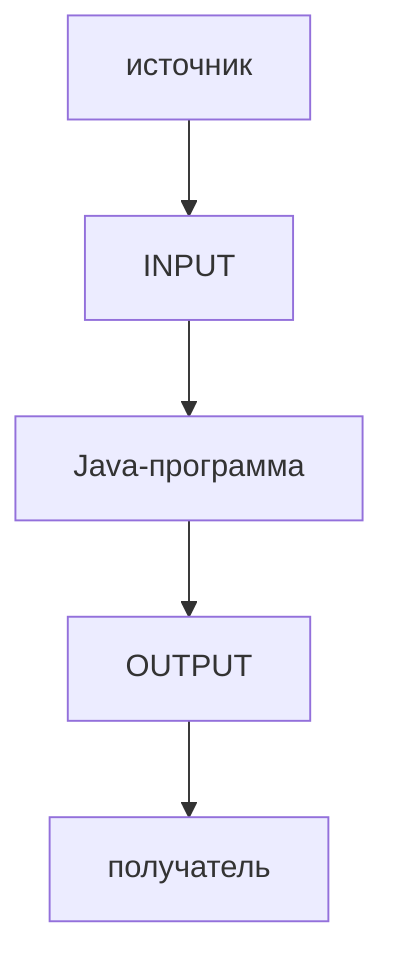

Например:

```text
клавиатура
→ input

консоль
→ output
```

Но источник и получатель могут быть другими:

```text
файл
сеть
другая программа
устройство
```

### Главное

> I/O — это обмен данными между программой и внешним миром.

---

# 2. Что такое поток ввода-вывода

При работе с I/O часто используется слово **stream — поток**.

Упрощённо поток можно представить как последовательность данных, которые проходят между источником и программой либо между программой и получателем.

Входящий поток:

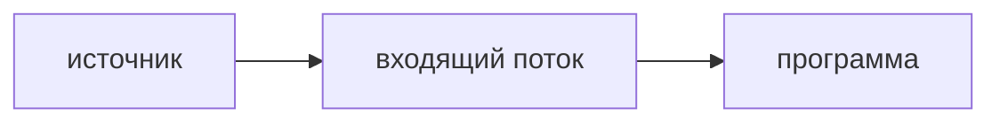

Исходящий поток:


Поток не обязательно означает, что все данные уже находятся в памяти одновременно. Наоборот, одна из важных идей I/O состоит в том, что данные можно получать и обрабатывать **постепенно**.

## Не путать со Stream API

Позже в курсе появится:

```text
Stream API
```

Это другой инструмент.

На этой неделе:

```text
I/O stream
→ передача данных
```

На неделе Stream API:

```text
Stream API
→ обработка последовательности данных
```

Слово `stream` одинаковое, но задачи разные.

### Главное

> В этой теме поток — это канал последовательного движения данных между программой и внешним миром.

---

# 3. Стандартные потоки Java

Когда Java-программа запускается, у неё уже есть три стандартных потока:

```text
System.in
→ стандартный ввод

System.out
→ стандартный вывод

System.err
→ стандартный вывод ошибок
```

Их не нужно создавать вручную.

---

## 3.1. `System.in`

`System.in` — стандартный входящий поток.

В обычной консольной программе он связан с пользовательским вводом:


Тип `System.in`:

```java
InputStream
```

На низком уровне программа получает байты.

Пока не нужно подробно изучать `InputStream`. Сейчас достаточно понимать:

> `System.in` — источник входных данных.

---

## 3.2. `System.out`

Мы уже давно используем:

```java
System.out.println("Hello");
```

Но теперь можно разобрать эту запись по частям:

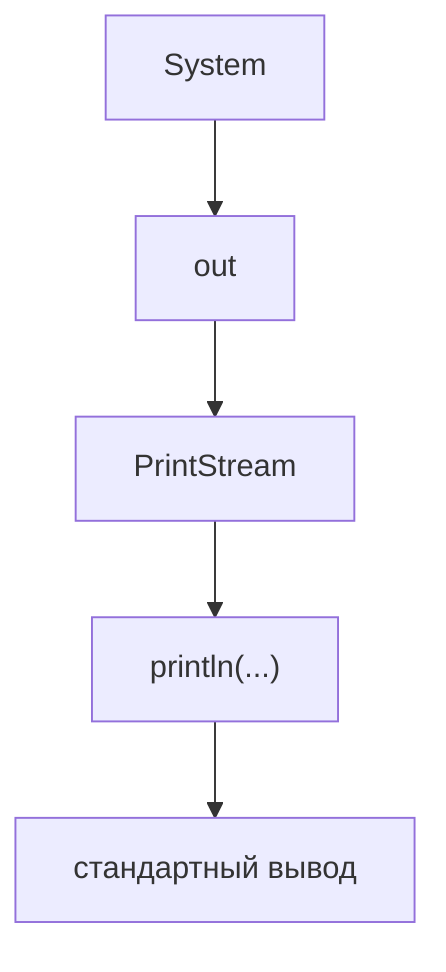

`out` — статическое поле класса `System`.

В нём находится объект типа:

```java
PrintStream
```

А `println(...)` — обычный метод этого объекта.

То есть:

```java
System.out.println("Hello");
```

не является специальной конструкцией языка Java.

Это обычный вызов метода.

---

## 3.3. `print()` и `println()`

```java
System.out.print("Hello ");
System.out.println("Java");
```

Результат:

```text
Hello Java
```

Разница:

```text
print(...)
→ выводит данные

println(...)
→ выводит данные
  и переводит строку
```

Например:

```java
System.out.print("A");
System.out.print("B");
System.out.print("C");
```

Результат:

```text
ABC
```

А:

```java
System.out.println("A");
System.out.println("B");
System.out.println("C");
```

даст:

```text
A
B
C
```

---

## 3.4. `System.err`

Для диагностических сообщений существует отдельный поток:

```java
System.err.println("Something went wrong");
```

Упрощённо:

```text
System.out
→ нормальный вывод программы

System.err
→ сообщения об ошибках
  и диагностическая информация
```

В IntelliJ IDEA оба потока обычно видны в окне `Run`, поэтому визуально разница может быть не очень заметна.

Но для окружения программы это два разных потока.

### Главное

> `System.in`, `System.out` и `System.err` — стандартные каналы взаимодействия Java-программы с окружением.

---

# 4. Чтение консольного ввода через `Scanner`

`System.in` предоставляет поток данных, но для обычного пользовательского ввода работать с ним напрямую неудобно.

Нам хочется получать не отдельные байты, а обычные значения Java:

```text
"Anna"
→ String

"25"
→ int

"18.5"
→ double
```

Для этого можно использовать класс `Scanner`.

```java
import java.util.Scanner;

Scanner scanner =
        new Scanner(System.in);
```

Схема:


`Scanner` работает **поверх** источника и умеет разбирать входные данные.

---

## 4.1. Читаем строку

Полный пример:

```java
import java.util.Scanner;

public class Main {

    public static void main(String[] args) {
        Scanner scanner =
                new Scanner(System.in);

        System.out.print("Введите имя: ");

        String name =
                scanner.nextLine();

        System.out.println(
                "Привет, " + name
        );
    }
}
```

Пример запуска:

```text
Введите имя: Anna
Привет, Anna
```

Метод:

```java
nextLine()
```

читает текущую строку целиком и возвращает `String`.

---

## 4.2. Читаем число

```java
Scanner scanner =
        new Scanner(System.in);

System.out.print("Введите возраст: ");

int age =
        scanner.nextInt();

System.out.println(
        "Возраст: " + age
);
```

Если пользователь вводит:

```text
20
```

`Scanner` должен не только прочитать символы, но и преобразовать их в `int`.

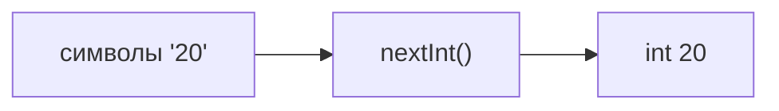

---

## 4.3. Базовые методы `Scanner`

Для текущей темы достаточно нескольких методов:

| Метод | Что делает |
|---|---|
| `nextLine()` | читает строку целиком |
| `nextInt()` | читает `int` |
| `nextDouble()` | читает `double` |
| `hasNextInt()` | проверяет, можно ли прочитать `int` |

Например:

```java
if (scanner.hasNextInt()) {
    int value = scanner.nextInt();
    System.out.println(value);
}
```

Не нужно запоминать весь API `Scanner`.

Важнее понять принцип:

> Выбирая метод чтения, программа задаёт ожидаемый формат входных данных.

---

# 5. Внешние данные могут быть некорректными

Представим:

```java
int age =
        scanner.nextInt();
```

Пользователь вводит:

```text
abc
```

`Scanner` не сможет преобразовать это значение в `int`.

Возникнет:

```text
InputMismatchException
```

Почему это важно?

Потому что данные пришли **извне**.

Программа не может заранее гарантировать, что пользователь введёт именно то, что от него ожидали.

С той же проблемой мы позже столкнёмся при работе с файлами:

```text
ожидали число
↓
в файле "abc"
↓
преобразование не удалось
```

### Главное

> Любой внешний ввод нужно считать потенциально некорректным.

---

# 6. Частая проблема: `nextInt()` и `nextLine()`

Рассмотрим программу:

```java
Scanner scanner =
        new Scanner(System.in);

System.out.print("Введите возраст: ");
int age = scanner.nextInt();

System.out.print("Введите имя: ");
String name = scanner.nextLine();

System.out.println("Возраст: " + age);
System.out.println("Имя: " + name);
```

На первый взгляд кажется, что после ввода возраста программа должна ждать имя.

Но часто `name` сразу становится пустой строкой.

## Почему

Когда пользователь вводит:

```text
20
```

и нажимает Enter, во входе фактически находится:

```text
20\n
```

где:

```text
\n
→ перевод строки
```

`nextInt()` читает только число:

```text
20
```

А перевод строки остаётся.

Следующий:

```java
scanner.nextLine();
```

читает остаток текущей строки.

Там находится только перевод строки.

Поэтому результат:

```text
""
```

Схема:

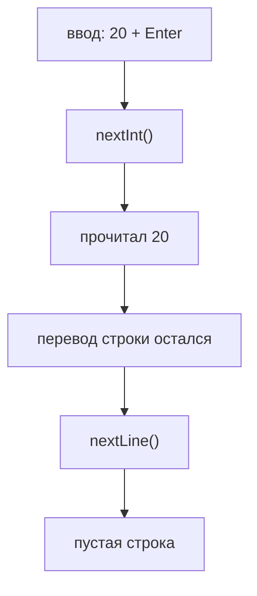

---

## Исправление

```java
int age = scanner.nextInt();

scanner.nextLine();

System.out.print("Введите имя: ");
String name = scanner.nextLine();
```

Первый `nextLine()` забирает остаток строки.

Второй уже ждёт новый пользовательский ввод.

```text
nextInt()
↓
20

nextLine()
↓
остаток текущей строки

nextLine()
↓
реальное имя
```

---

## Альтернативный вариант

В небольших программах можно читать всё через `nextLine()`:

```java
String text =
        scanner.nextLine();

int age =
        Integer.parseInt(text);
```

Тогда чтение всегда работает одинаково, а преобразование выполняется отдельно.

### Главное

> `nextInt()` и `nextLine()` работают по-разному. При их сочетании нужно помнить о переводе строки.

---

# 7. `Scanner` и закрытие ресурса

`Scanner` реализует интерфейс:

```java
Closeable
```

Поэтому его можно закрыть:

```java
scanner.close();
```

Но есть важный нюанс.

Если Scanner создан так:

```java
new Scanner(System.in)
```

то:

```java
scanner.close();
```

закроет и:

```text
System.in
```

После этого стандартный ввод больше нельзя нормально использовать.

Поэтому в небольшой консольной программе обычно создают один `Scanner` на всё время работы приложения.

Это первый пример общей идеи:

```text
обёртка
↓
использует нижележащий ресурс
↓
закрытие обёртки
может закрыть и ресурс
```

С файлами эта тема станет намного важнее.

---

# 8. Зачем Java-приложению файлы

Файлы используются далеко не только как учебный пример.

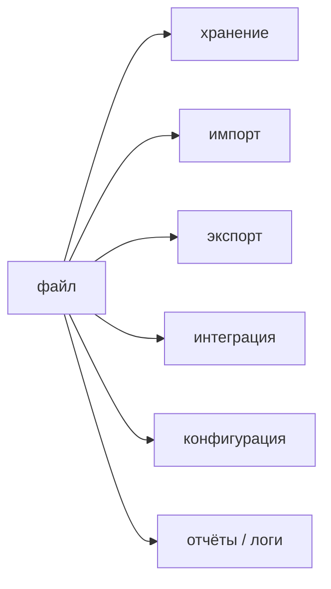

---

## 8.1. Простое хранение

Программа может записать:

```text
users.txt
```

а при следующем запуске снова его прочитать.

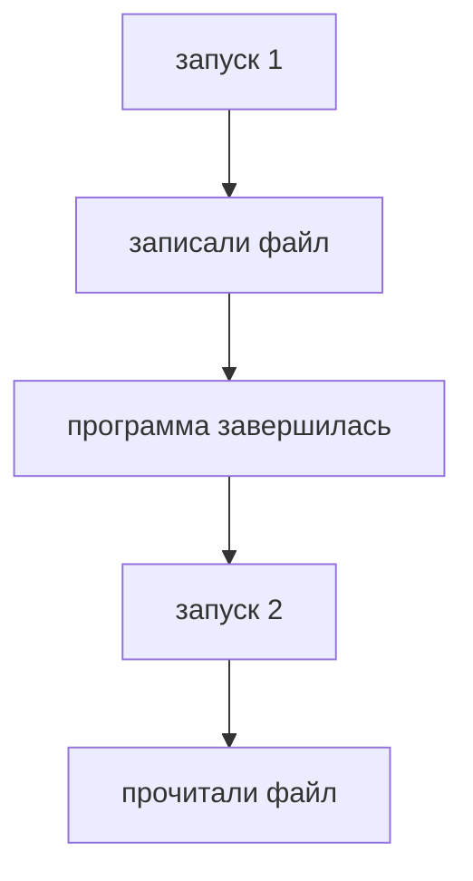

Для маленькой программы файл иногда может играть роль очень простого постоянного хранилища.

---

## 8.2. Импорт данных

Например, программа получает:

```text
students.txt
orders.csv
results.txt
```

и превращает записи в объекты:

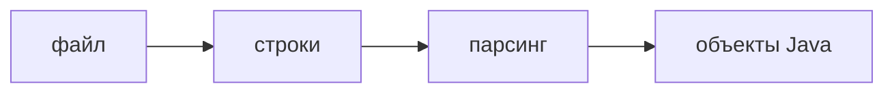

---

## 8.3. Экспорт

Обратное направление:


Например, программа формирует:

```text
report.txt
```

---

## 8.4. Интеграция между системами

Одна система может сформировать файл, а другая — прочитать.

Например:

```text
orders.csv
```

Тогда формат файла становится контрактом:

```text
какие поля
в каком порядке
какой разделитель
какая кодировка
какие значения допустимы
```

Обе системы должны понимать этот формат одинаково.

---

## 8.5. Конфигурация

Файл может содержать настройки:

```text
host=localhost
port=8080
```

Идея:

```text
настройки находятся вне кода
↓
программа читает их при запуске
```

Позже появятся более специализированные механизмы конфигурации, но сама идея останется той же.

---

## 8.6. Файл не всегда заменяет базу данных

Файл хорошо подходит, если:

```text
данных немного
структура простая
доступ последовательный
приложение небольшое
```

Но когда появляются:

```text
много данных
сложный поиск
несколько пользователей
транзакции
сложные связи
```

обычно нужна база данных.

### Главное

> Файл — базовый механизм хранения и обмена данными, но не универсальная замена БД.

---

# 9. Что физически хранится в файле

Текстовый файл может выглядеть так:

```text
Hello
Привет
42
```

Но на диске он хранит не объекты `String`.

Файл физически состоит из:

```text
байтов
```

Например:

```text
01001000
01101001
...
```

Даже если расширение:

```text
.txt
```

физическая природа не меняется.

Расширение лишь говорит, что эти байты предполагается воспринимать как текст.

---

# 10. Байтовый и текстовый I/O

## Байтовый I/O

```java
byte[] data =
        Files.readAllBytes(path);
```

Программа получает сырые байты.

Такой подход подходит для:

```text
изображений
архивов
бинарных файлов
```

---

## Текстовый I/O

```java
String text =
        Files.readString(path);
```

Программа получает текст.

Подходит для:

```text
.txt
простых .csv
конфигурации
текстовых отчётов
```

Сравнение:

| Байтовый I/O | Текстовый I/O |
|---|---|
| `byte[]` | `String` / символы |
| сырые данные | текст |
| не интерпретирует символы | использует кодировку |
| бинарные форматы | текстовые форматы |

### Главное

> Один и тот же файл физически содержит байты. Разница в том, как программа их интерпретирует.

---

# 11. Кодировка

Чтобы превратить байты в символы, нужна **кодировка**.

Она задаёт соответствие:

```text
символы ↔ байты
```

При записи:

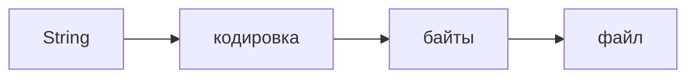

При чтении:


Если при записи и чтении используется одна и та же кодировка, символы восстанавливаются корректно.

---

# 12. UTF-8

Для курса используем:

```java
StandardCharsets.UTF_8
```

Чтение:

```java
String text =
        Files.readString(
                path,
                StandardCharsets.UTF_8
        );
```

Запись:

```java
Files.writeString(
        path,
        text,
        StandardCharsets.UTF_8
);
```

Перегрузки `Files.readString(path)` и `Files.writeString(path, text)` без явного `Charset` тоже работают с UTF-8.

Но явное указание кодировки делает формат файла заметным прямо в коде.

### Правило курса

> Если нет отдельного требования — используем UTF-8.

---

# 13. Что будет при неправильной кодировке

Запишем строку:

```text
Привет
```

в UTF-8:

```java
Files.writeString(
        path,
        "Привет",
        StandardCharsets.UTF_8
);
```

Теперь прочитаем те же байты другой кодировкой:

```java
import java.nio.charset.Charset;

String text =
        Files.readString(
                path,
                Charset.forName("windows-1252")
        );
```

Можно получить:

```text
Привет
```

Байты файла при этом не обязательно испорчены.

Проблема в интерпретации.

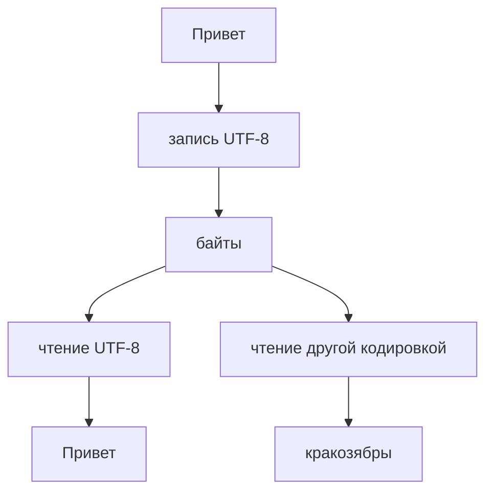

### Главное

> Неверная кодировка не меняет байты файла — она заставляет программу неправильно их интерпретировать.

---

# 14. `Path`: где находится файл

Перед чтением нужно указать расположение файла.

Для этого используется:

```java
Path
```

Например:

```java
import java.nio.file.Path;

Path path =
        Path.of(
                "data",
                "students.txt"
        );
```

`Path` — это описание расположения.

```text
Path
≠
файл
≠
содержимое файла
```

Один и тот же `Path` можно передать разным операциям:

```java
Files.exists(path);
Files.readString(path);
Files.writeString(path, "Hello");
```

---

# 15. Почему пути лучше собирать через `Path`

Можно написать:

```java
String path =
        "data/" + "students.txt";
```

Но лучше:

```java
Path path =
        Path.of(
                "data",
                "students.txt"
        );
```

или:

```java
Path directory =
        Path.of("data");

Path file =
        directory.resolve(
                "students.txt"
        );
```

Почему?

## `Path` знает правила файловой системы

Не нужно вручную выбирать:

```text
/
```

или:

```text
\
```

## Путь — структура, а не просто текст

Можно получить:

```java
path.getFileName();
path.getParent();
path.toAbsolutePath();
```

## Код становится понятнее

```java
directory.resolve("students.txt");
```

означает:

> получить путь к `students.txt` внутри `directory`.

### Главное

> Для файлового пути существует специальный тип `Path`, поэтому его лучше использовать вместо ручной склейки строк.

---

# 16. Полезные операции `Path`

```java
Path path =
        Path.of(
                "data",
                "students.txt"
        );
```

Имя файла:

```java
path.getFileName();
```

Результат:

```text
students.txt
```

Родитель:

```java
path.getParent();
```

Результат:

```text
data
```

Абсолютное представление:

```java
path.toAbsolutePath();
```

Например:

```text
/Users/student/IdeaProjects/course/data/students.txt
```

Эти операции работают со структурой пути и не читают файл.

---

# 17. Абсолютный и относительный путь

## Абсолютный

Полностью описывает расположение.

macOS / Linux:

```text
/Users/student/project/data/students.txt
```

Windows:

```text
C:\Users\student\project\data\students.txt
```

---

## Относительный

```text
data/students.txt
```

считается относительно **working directory** запущенной программы.

---

# 18. Где Java ищет относительный файл

Пусть рабочий каталог:

```text
/Users/student/IdeaProjects/java-course
```

Код:

```java
Path path =
        Path.of(
                "data",
                "students.txt"
        );
```

Фактически Java будет работать с:

```text
/Users/student/IdeaProjects/java-course/data/students.txt
```

Проверить working directory:

```java
System.out.println(
        System.getProperty("user.dir")
);
```

Посмотреть фактический путь:

```java
System.out.println(
        path.toAbsolutePath()
);
```

Это особенно полезно при ошибке:

```text
No such file or directory
```

---

## IntelliJ IDEA

Рабочий каталог задаётся в:

```text
Run
→ Edit Configurations...
→ Working directory
```

Важно:

> Относительный путь не считается автоматически от `Main.java`, `src` или скомпилированного `.class`.

---

# 19. Не привязываем путь к одному компьютеру

Плохо:

```java
Path path = Path.of(
        "/Users/ivan/Desktop/project/data.txt"
);
```

Почему:

```text
другой пользователь
другая ОС
другой каталог проекта
↓
путь уже неверный
```

В учебном проекте лучше:

```java
Path path =
        Path.of(
                "data",
                "data.txt"
        );
```

Абсолютные пути очень полезны для диагностики, но обычно не должны быть жёстко прописаны в переносимом коде.

---

# 20. `Files`: операции с файловой системой

Если `Path` отвечает:

> Где?

то `Files` отвечает:

> Что сделать?

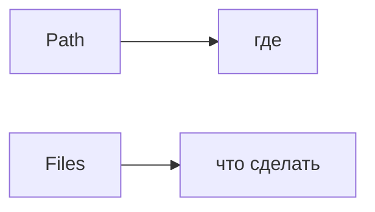

Примеры:

```java
Files.exists(path);
Files.readString(path);
Files.writeString(path, text);
```

`Files` — utility-класс со статическими методами.

---

# 21. Проверяем файл и каталог

Существует ли:

```java
Files.exists(path);
```

Обычный ли файл:

```java
Files.isRegularFile(path);
```

Каталог ли:

```java
Files.isDirectory(path);
```

Например:

```java
if (!Files.exists(path)) {
    System.out.println(
            "Файл не найден"
    );
}
```

Проверки полезны для логики, но не гарантируют, что следующая I/O-операция обязательно будет успешной.

---

# 22. Создаём каталоги

```java
Path directory =
        Path.of(
                "data",
                "reports"
        );

Files.createDirectories(directory);
```

Если части пути отсутствуют, они будут созданы.

Например:

```text
data/
└── reports/
```

Это удобно перед записью отчётов или других результатов.

---

# 23. Читаем небольшой текстовый файл

Пусть файл:

```text
data/message.txt
```

содержит:

```text
Hello, Java!
```

Пример:

```java
import java.io.IOException;
import java.nio.charset.StandardCharsets;
import java.nio.file.Files;
import java.nio.file.Path;

public class Main {

    public static void main(String[] args)
            throws IOException {

        Path path =
                Path.of(
                        "data",
                        "message.txt"
                );

        String text =
                Files.readString(
                        path,
                        StandardCharsets.UTF_8
                );

        System.out.println(text);
    }
}
```

Схема:


Этот подход хорош, когда файл небольшой и всё содержимое нужно сразу.

---

# 24. Почему появляется `IOException`

Файл — внешний ресурс.

Даже если код написан правильно, может случиться:

```text
файла нет
нет прав
путь указывает на каталог
ошибка файловой системы
ошибка устройства
```

Поэтому:

```java
Files.readString(path);
```

может выбросить:

```text
IOException
```

`IOException` — checked exception.

Компилятор требует:

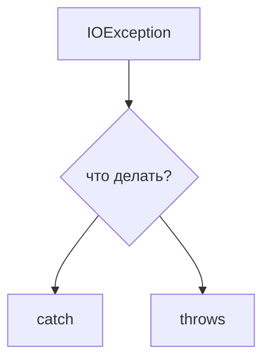

Это прямое применение материала недели 6.

---

# 25. Обработка ошибки чтения

```java
try {
    String text =
            Files.readString(
                    path,
                    StandardCharsets.UTF_8
            );

    System.out.println(text);

} catch (IOException e) {
    System.out.println(
            "Не удалось прочитать файл"
    );
}
```

У программы появляются два сценария:

```text
успех
↓
получили String
↓
работаем дальше
```

или:

```text
IOException
↓
catch
↓
альтернативная реакция
```

### Главное

> `catch` не предотвращает ошибку. Он описывает реакцию приложения на ошибочный сценарий.

---

# 26. Где ловить `IOException`

Не обязательно писать `catch` прямо около каждого вызова `Files`.

Например:

```java
static String loadText(Path path)
        throws IOException {

    return Files.readString(
            path,
            StandardCharsets.UTF_8
    );
}
```

Низкоуровневый метод знает:

```text
чтение не удалось
```

Но верхний уровень может знать:

```text
попросить другой файл
использовать значения по умолчанию
прервать импорт
сообщить пользователю
```

### Главное

> Исключение лучше обрабатывать там, где есть достаточно контекста, чтобы принять осмысленное решение.

---

# 27. Записываем текстовый файл

Обратная операция:

```text
String
↓
файл
```

```java
Path path =
        Path.of(
                "data",
                "result.txt"
        );

Files.writeString(
        path,
        "Hello, Java!",
        StandardCharsets.UTF_8
);
```

Обычно:

```text
файла нет
→ создаётся

файл есть
→ содержимое заменяется
```

Схема:

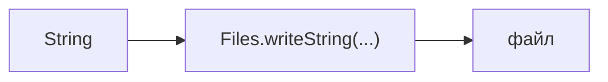

---

# 28. Дописываем в конец

Иногда старое содержимое нужно сохранить.

Например, для простого журнала:

```java
import static java.nio.file.StandardOpenOption.APPEND;
import static java.nio.file.StandardOpenOption.CREATE;

Files.writeString(
        path,
        "next line\n",
        StandardCharsets.UTF_8,
        CREATE,
        APPEND
);
```

```text
CREATE
→ создать файл, если его нет

APPEND
→ писать в конец
```

Все режимы `StandardOpenOption` пока изучать не нужно.

Главное:

> Режим записи — часть контракта файловой операции.

---

# 29. Что будет, если файл слишком большой

`Files.readString(...)` должен получить весь файл как один `String`.

```mermaid
flowchart TD
    A["файл целиком"] --> B["readString"]
    B --> C["один большой String"]
    C --> D["heap JVM"]
```

Для небольшого файла это удобно.

Но большой файл может:

- занять много памяти;
- увеличить нагрузку на Garbage Collector;
- замедлить программу;
- в крайнем случае привести к `OutOfMemoryError`.

Например, файл размером в несколько гигабайт обычно не стоит читать как один огромный `String`.

Нужна постепенная обработка.

---

# 30. Читаем файл постепенно

Вместо:

```text
весь файл
↓
вся память сразу
```

можно:

```text
строка
↓
обработка
↓
следующая строка
↓
обработка
```

```mermaid
flowchart TD
    A["строка 1"] --> B["обработка"]
    B --> C["строка 2"]
    C --> D["обработка"]
    D --> E["..."]
```

Для текстового файла удобно использовать:

```java
BufferedReader
```

---

# 31. `BufferedReader`

Reader можно открыть так:

```java
BufferedReader reader =
        Files.newBufferedReader(
                path,
                StandardCharsets.UTF_8
        );
```

Он позволяет читать текст постепенно.

Самый важный метод:

```java
readLine()
```

---

# 32. Читаем строку за строкой

```java
String line;

while ((line = reader.readLine()) != null) {
    System.out.println(line);
}
```

Механика:

```text
readLine()
↓
строка 1
↓
обработка

readLine()
↓
строка 2
↓
обработка

...

readLine()
↓
null
```

`null` означает, что строк больше нет.

Важно:

```text
""
→ пустая строка

null
→ конец файла
```

Это не одно и то же.

---

# 33. `BufferedReader` — ресурс

Reader нужно закрыть.

Наивный вариант:

```java
BufferedReader reader =
        Files.newBufferedReader(path);

String line =
        reader.readLine();

reader.close();
```

Но если между открытием и `close()` возникнет исключение:

```text
reader открыт
↓
exception
↓
до close() не дошли
```

Так появляется реальная мотивация для try-with-resources.

---

# 34. Try-with-resources для чтения

```java
try (BufferedReader reader =
             Files.newBufferedReader(
                     path,
                     StandardCharsets.UTF_8
             )) {

    String line;

    while ((line = reader.readLine()) != null) {
        System.out.println(line);
    }
}
```

После выхода из блока Java автоматически вызовет:

```java
reader.close();
```

При обычном завершении:

```text
try
↓
работа
↓
close()
```

При исключении:

```text
try
↓
exception
↓
close()
```

---

# 35. Почему автоматическое закрытие работает

`BufferedReader` реализует:

```java
AutoCloseable
```

У него есть:

```java
close()
```

Try-with-resources умеет работать с объектами этого типа.

```mermaid
flowchart TD
    A["BufferedReader"] --> B["AutoCloseable"]
    B --> C["close()"]
    C --> D["try-with-resources"]
```

Это тот же механизм, который был изучен на неделе исключений.

### Главное

> Try-with-resources связывает жизненный цикл ресурса с блоком `try`.

---

# 36. `BufferedWriter`

Для постепенной записи существует:

```java
BufferedWriter
```

Пример:

```java
try (BufferedWriter writer =
             Files.newBufferedWriter(
                     path,
                     StandardCharsets.UTF_8
             )) {

    writer.write("first");
    writer.newLine();

    writer.write("second");
}
```

В файл попадёт:

```text
first
second
```

`newLine()` добавляет перевод строки.

---

# 37. Reader и Writer

| Чтение | Запись |
|---|---|
| `BufferedReader` | `BufferedWriter` |
| `readLine()` | `write(...)` |
| читает текст | записывает текст |
| ресурс | ресурс |
| try-with-resources | try-with-resources |

```mermaid
flowchart LR
    A["файл"] --> B["BufferedReader"]
    B --> C["Java-программа"]
    C --> D["BufferedWriter"]
    D --> E["файл"]
```

Внутреннее устройство буферизации пока подробно не разбираем.

Главная идея:

> Reader и writer позволяют работать с текстом постепенно.

---

# 38. Почему `Files.exists()` не гарантирует успех чтения

Можно написать:

```java
if (Files.exists(path)) {
    String text =
            Files.readString(path);
}
```

Но между двумя операциями состояние файловой системы может измениться:

```text
exists == true
↓
другая программа удалила файл
↓
readString()
↓
IOException
```

Или файл существует, но нет прав на чтение.

Поэтому:

```text
Files.exists(path)
→ проверка состояния

Files.readString(path)
→ реальная операция
```

### Главное

> Проверка `exists()` полезна, но она не заменяет обработку `IOException`.

---

# 39. Из строки файла в объект

Пусть файл содержит:

```text
Marta;91
```

А в программе есть:

```java
public class Student {

    private String name;
    private int score;

    public Student(
            String name,
            int score
    ) {
        this.name = name;
        this.score = score;
    }
}
```

Нам нужен переход:

```mermaid
flowchart LR
    A["Marta;91"] --> B["разбор"]
    B --> C["name = Marta"]
    B --> D["score = 91"]
    C --> E["Student"]
    D --> E
```

Файл содержит внешнее представление данных.

Объект — внутреннюю модель программы.

---

# 40. Разбираем строку файла

```java
String line =
        "Marta;91";

String[] parts =
        line.split(";");

String name =
        parts[0];

int score =
        Integer.parseInt(
                parts[1]
        );

Student student =
        new Student(
                name,
                score
        );
```

Пошагово:

```mermaid
flowchart TD
    A["Marta;91"] --> B["split(';')"]
    B --> C["Marta"]
    B --> D["91"]
    D --> E["parseInt"]
    E --> F["int 91"]
    C --> G["new Student(...)"]
    F --> G
```

После этого программа работает с обычным объектом.

---

# 41. Из объекта обратно в строку

Для сохранения нужен обратный переход.

Например:

```java
public String toFileString() {
    return name + ";" + score;
}
```

Объект:

```text
name = Marta
score = 91
```

превращается в:

```text
Marta;91
```

После этого:

```java
Files.writeString(
        path,
        student.toFileString(),
        StandardCharsets.UTF_8
);
```

### Главное

> Чтобы сохранить объект в текстовый файл, нужно определить его текстовое представление.

---

# 42. Формат файла — это контракт

Если программа ожидает:

```text
name;score
```

она предполагает:

```text
две части
разделитель ;
первая часть — имя
вторая часть — число
кодировка — UTF-8
```

Корректно:

```text
Marta;91
```

Некорректно:

```text
Marta
```

```text
Marta;91;extra
```

```text
Marta;abc
```

Файл недостаточно просто прочитать.

Его содержимое нужно интерпретировать по правилам формата.

---

# 43. Ошибка структуры и ошибка значения

Рассмотрим:

```java
String[] parts =
        line.split(";");

int score =
        Integer.parseInt(
                parts[1]
        );
```

Для:

```text
Marta
```

может не существовать:

```text
parts[1]
```

Это проблема структуры записи.

Для:

```text
Marta;abc
```

структура есть, но число некорректно.

Это проблема значения.

```mermaid
flowchart TD
    A["строка"] --> B{"структура корректна?"}
    B -->|нет| C["ошибка структуры"]
    B -->|да| D{"значения корректны?"}
    D -->|нет| E["ошибка значения"]
    D -->|да| F["создаём объект"]
```

### Главное

> Внешний формат нужно проверять и по структуре, и по значениям.

---

# 44. Несколько объектов в файле

Файл:

```text
Marta;91
Ivan;74
Alice;88
```

Коллекции будут изучаться только на следующей неделе.

Но уже сейчас можно обрабатывать файл построчно:

```text
readLine()
↓
разобрать
↓
создать Student
↓
обработать
↓
следующая строка
```

Например:

- вывести каждого студента;
- посчитать количество;
- найти максимальный `score`;
- посчитать сумму;
- записать результат в другой файл.

Хранить все объекты одновременно не обязательно.

---

# 45. Ошибки I/O и ошибки содержимого

Пусть файл:

```text
Marta;91
Ivan;abc
Alice;88
```

Для:

```java
Integer.parseInt("abc");
```

возникнет:

```text
NumberFormatException
```

Но это не то же самое, что `IOException`.

| Исключение | Что произошло |
|---|---|
| `IOException` | не удалось выполнить I/O |
| `NumberFormatException` | данные прочитали, но значение имеет неверный формат |

Схема:

```mermaid
flowchart TD
    A["файл"] --> B["чтение"]
    B -->|IOException| C["ошибка I/O"]
    B -->|успех| D["парсинг"]
    D -->|ошибка| E["ошибка данных"]
    D -->|успех| F["объект"]
```

### Главное

> Один импорт может одновременно иметь ошибки разных уровней.

---

# 46. Что делать с плохой строкой

Универсального ответа нет.

## Вариант 1. Остановить импорт

```text
Marta;91
Ivan;abc
↓
ошибка
↓
импорт прекращён
```

Подходит, если весь файл обязан быть корректным.

Например, для строгой конфигурации.

---

## Вариант 2. Сообщить и продолжить

```text
Marta;91
→ импортировали

Ivan;abc
→ ошибка

Alice;88
→ импортировали
```

Такой подход может быть удобнее для пакетной обработки.

### Главное

> Реакция на ошибочную запись — часть контракта импортера.

---

# 47. Типичные ошибки

## Жёсткий абсолютный путь

Плохо:

```java
Path.of(
        "/Users/ivan/Desktop/data.txt"
);
```

Код привязан к конкретному компьютеру.

---

## Непонимание working directory

Студент пишет:

```java
Path.of("data.txt");
```

и ожидает, что файл будет искаться рядом с `Main.java`.

Диагностика:

```java
System.out.println(
        Path.of("data.txt")
                .toAbsolutePath()
);
```

---

## Неправильная кодировка

Файл корректен, но читается другой кодировкой.

Симптом:

```text
кракозябры
```

---

## Чтение большого файла через `readString()`

```java
String text =
        Files.readString(path);
```

удобно только пока весь файл разумно помещается в память.

Для больших файлов лучше построчная обработка.

---

## Ручной `close()`

Плохо:

```java
BufferedReader reader =
        Files.newBufferedReader(path);

reader.readLine();

reader.close();
```

При исключении до `close()` можно не дойти.

Лучше:

```java
try (BufferedReader reader =
             Files.newBufferedReader(path)) {
    ...
}
```

---

## `catch (Exception e)`

Слишком общий `catch` скрывает смысл проблемы.

Лучше различать:

```text
IOException
→ I/O

NumberFormatException
→ формат данных
```

---

# 48. Как выбрать способ чтения

## Маленький текстовый файл

```java
Files.readString(path)
```

Когда:

```text
файл небольшой
+
нужно всё содержимое сразу
```

---

## Большой текстовый файл

```java
BufferedReader
```

Когда:

```text
файл большой
или
данные удобно обрабатывать построчно
```

---

## Небольшой бинарный файл

```java
Files.readAllBytes(path)
```

Когда нужны именно байты.

Для очень больших бинарных файлов существуют другие потоковые API, но подробно их на этой неделе не рассматриваем.

---

# 49. Что пока не изучаем подробно

Java I/O — большая тема.

На этой неделе сознательно не углубляемся в:

- `FileInputStream`;
- `FileOutputStream`;
- `DataInputStream`;
- `DataOutputStream`;
- `FileChannel`;
- `ByteBuffer`;
- memory-mapped files;
- асинхронный I/O;
- `WatchService`;
- Java Serialization;
- JSON-библиотеки;
- CSV-библиотеки;
- сложные режимы открытия файлов.

Также не делаем основной упор на:

```java
Files.readAllLines(...)
```

потому что он возвращает:

```java
List<String>
```

а коллекции будут изучаться на следующей неделе.

Не используем и:

```java
Files.lines(...)
```

потому что он связан со Stream API, которое будет позже.

---

# 50. Общая модель Java I/O

## Консоль

```mermaid
flowchart LR
    A["клавиатура"] --> B["System.in"]
    B --> C["Scanner"]
    C --> D["Java-программа"]
    D --> E["System.out / System.err"]
    E --> F["терминал"]
```

---

## Небольшой текстовый файл

```mermaid
flowchart LR
    A["Path"] --> B["Files.readString"]
    B --> C["String"]
    C --> D["Java-программа"]
    D --> E["Files.writeString"]
    E --> F["файл"]
```

---

## Большой текстовый файл

```mermaid
flowchart LR
    A["Path"] --> B["BufferedReader"]
    B --> C["строка"]
    C --> D["обработка"]
    D --> E["BufferedWriter"]
    E --> F["файл"]
```

---

# 51. Общая модель работы с текстовым файлом

```mermaid
flowchart TD
    A["Path"] --> B["где находится файл"]
    B --> C["Files / Reader / Writer"]
    C --> D["операция"]
    D --> E["Charset"]
    E --> F["байты ↔ текст"]
    F --> G["String"]
    G --> H["парсинг / форматирование"]
    H --> I["объекты"]
```

Каждый уровень отвечает на свой вопрос:

```text
Path
→ где файл?

Files / Reader / Writer
→ что делаем?

Charset
→ как байты превращаются в текст?

String
→ какое текстовое представление получили?

парсинг
→ как получить типизированные значения?

объект
→ как приложение работает с данными дальше?
```

---

# 52. Связь с исключениями и ресурсами

Неделя 6 дала инструменты:

```text
try
catch
throws
AutoCloseable
try-with-resources
```

Неделя 7 показывает, зачем они нужны на практике.

```mermaid
flowchart TD
    A["I/O операция"] --> B{"успех?"}
    B -->|да| C["продолжаем"]
    B -->|нет| D["IOException"]
    D --> E["catch / throws"]
```

Для ресурсов:

```mermaid
flowchart TD
    A["BufferedReader / BufferedWriter"] --> B["AutoCloseable"]
    B --> C["try-with-resources"]
    C --> D["автоматический close()"]
```

### Главное

> Работа с файлами объединяет сразу две темы: I/O может завершаться исключением, а открытые ресурсы нужно гарантированно закрывать.

---

# 53. Практический итог: импорт результатов

Есть файл:

```text
data/results.txt
```

Содержимое:

```text
Marta;91
Ivan;74
Alice;88
```

Есть класс:

```java
public class Student {

    private String name;
    private int score;

    public Student(
            String name,
            int score
    ) {
        this.name = name;
        this.score = score;
    }

    public int getScore() {
        return score;
    }

    @Override
    public String toString() {
        return name + ": " + score;
    }
}
```

Общая задача:

```mermaid
flowchart TD
    A["results.txt"] --> B["читать построчно"]
    B --> C["разобрать name;score"]
    C --> D["создать Student"]
    D --> E["обработать"]
    E --> F["следующая строка"]
```

Например, можно найти максимальный `score`, не сохраняя все объекты одновременно.

Это объединяет:

- строки;
- массив после `split`;
- `Integer.parseInt`;
- классы и объекты;
- исключения;
- `Path`;
- `BufferedReader`;
- try-with-resources.

---

# 54. Практический итог: формируем отчёт

Продолжим задачу:

```text
results.txt
↓
прочитать студентов
↓
посчитать количество
↓
найти лучший score
↓
записать report.txt
```

Например:

```text
Students: 3
Best score: 91
```

Модель:

```mermaid
flowchart LR
    A["results.txt"] --> B["BufferedReader"]
    B --> C["парсинг"]
    C --> D["Student"]
    D --> E["обработка"]
    E --> F["BufferedWriter"]
    F --> G["report.txt"]
```

Это уже похоже на небольшой настоящий импортёр данных.

---

# 55. Что нужно понимать после недели

После темы нужно уметь объяснить:

- что такое input и output;
- что такое I/O stream;
- для чего нужны `System.in`, `System.out`, `System.err`;
- как работает `Scanner`;
- почему `nextInt()` и `nextLine()` могут конфликтовать;
- почему файл физически хранит байты;
- зачем тексту нужна кодировка;
- почему используем UTF-8;
- чем байтовый I/O отличается от текстового;
- зачем нужен `Path`;
- чем абсолютный путь отличается от относительного;
- откуда Java считает относительный путь;
- зачем нужен `Files`;
- как прочитать и записать небольшой файл;
- почему файловый I/O связан с `IOException`;
- почему `Files.exists()` не гарантирует успех чтения;
- почему большой файл не стоит всегда читать через `readString()`;
- как читать файл через `BufferedReader`;
- как записывать через `BufferedWriter`;
- зачем нужен try-with-resources;
- как преобразовать строку файла в объект;
- почему формат файла является контрактом;
- чем I/O-ошибка отличается от ошибки содержимого файла.

---

# 56. Итог недели

Главная цепочка:

```mermaid
flowchart TD
    A["внешний мир"] --> B["I/O"]
    B --> C["Java-программа"]
    C --> D["файл"]
    D --> E["байты"]
    E --> F["кодировка"]
    F --> G["String"]
    G --> H["парсинг"]
    H --> I["объекты"]
```

Для небольшого файла:

```text
Path
↓
Files.readString / Files.writeString
```

Для постепенной обработки:

```text
Path
↓
BufferedReader / BufferedWriter
↓
try-with-resources
```

Для ошибок:

```text
I/O
↓
IOException
↓
catch / throws
```

Для предметной модели:

```text
файл
↓
String
↓
парсинг
↓
объект
```

И обратно:

```text
объект
↓
текстовый формат
↓
файл
```

---

# 57. Переход к следующей неделе

Теперь мы умеем читать:

```text
1 объект
10 объектов
100 объектов
```

Но возникает новая проблема:

```text
количество объектов
заранее неизвестно
```

Массив неудобен, если размер набора заранее не известен.

Нужна структура, которая:

```text
хранит много элементов
+
может увеличиваться
по мере добавления
```
